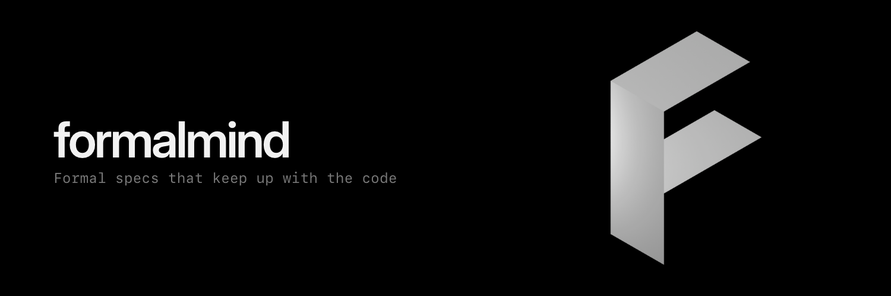

<p align="center"></p>

# Formal Mind

Formal Mind is a swarm of agents for verifying Ethereum smart contracts. Point it at a Solidity repository and the agents write
a Lean 4 specification of it, prove it, and keep the proofs up to date as the code changes. Every theorem is
machine-checked by `lake build`, with no `sorry` and no new axioms.

- **Web:** [formal.team](https://formal.team). Paste a repository, watch the plan, start the swarm.
- **Mac:** [Download for Mac](https://github.com/formalmind/formalmind/releases/latest/download/Formal-Mind-mac.dmg).
  Also runs agent turns on folders on your machine, so the code never leaves it ([desktop/](desktop/README.md)).

## How it works

A planner breaks the work into small issues, provers write the Lean, a reviewer checks each statement against the
Solidity, and a merger merges only when `lake build` is clean. A human is asked only when a decision is needed.

## Example: Async Swap

[`asyncswap/contracts`](https://github.com/asyncswap/contracts) is the protocol (Solidity), with its Lean proofs in
`formal/` and Formal Mind's audit in `audit/`, versioned with the code:

```text
asyncswap/contracts
├── src/                          the contracts: AsyncSwap, Router, FeeVault, NativeClaims, …
├── script/                       Foundry scripts; what they deploy or call is the audit's scope
├── formal/                       Lean 4 + Mathlib; CI runs lake build, no sorry, admit or axiom
│   ├── AsyncSwapSpec/            specs, close to the code
│   │   ├── Fee.lean              the protocol fee
│   │   ├── Match.lean            matching never fills below a limit price or overspends escrow
│   │   ├── Book.lean             the escrow invariant, preserved by every state transition
│   │   ├── RadixTree.lean        RadixPriceTree: best() is the exact max/min
│   │   └── …
│   ├── AsyncSwapProtocol/        the whole system as one state machine: Router → PoolManager → hook → FeeVault
│   │   └── V2/                   escrow, balance, claims, backing, conservation and supply invariants
│   ├── Generated/                the Lean model of each contract, generated by formal-ast from solc's AST
│   ├── Refinement/               theorems that each generated def implements its spec step
│   │   └── Swarm/                one file per function, written by the swarm and checked by its reviewer
│   └── scripts/generate.sh       regenerates Generated/ after src/ changes
└── audit/
    ├── README.md                 the audit index
    ├── formal-mind.audit.json    Formal Mind's audit (formalmind.audit/v1): coverage per contract, properties proved
    └── formal-mind.pdf           the same, as a report
```

The layers split the work. `AsyncSwapSpec/` and `AsyncSwapProtocol/` prove properties of abstract models.
`Generated/` is the code itself in Lean, and `Refinement/` proves each generated def implements its step of the model,
so the model's invariants hold for the contracts. The Proofs tab counts a function as proved when a theorem names its
generated def. A spec theorem reads like this:

```lean
/-- **Main matching theorem.** A non-zero match honours both limit prices and both escrows. -/
theorem matchAmounts_sound (sell buy : Order) (rb : Bool) …
```

At the audited commit, `audit/formal-mind.audit.json` counts 95 of `AsyncSwap`'s 143 functions proved and 25 of
`Router`'s 46, with no `sorry`, and 42 reviewed properties. See [docs/audit-format.md](docs/audit-format.md) for the
format.

## For agents

formal.team publishes the discovery files Cloudflare's Agent Readiness scanner (isitagentready.com) looks for, all served by
the Worker from `worker/discovery.ts`, `worker/markdown.ts`, `worker/skills.ts`, `worker/wellKnown.ts` and `worker/mcp.ts`,
with the facts they share in `worker/narrative.ts`. Every claim in them is checkable against this repository; anything not
built yet is labelled planned.

| Path | What it is |
| --- | --- |
| `/robots.txt`, `/sitemap.xml` | RFC 9309 rules with explicit AI-crawler groups and `Content-Signal: search=yes, ai-input=yes, ai-train=no`; the public pages |
| `/llms.txt`, `/llms-full.txt` | Orientation and the full account of Formal Mind for agents (llmstxt.org) |
| `/auth.md` | How people sign in (GitHub) and how agents get account-scoped OAuth 2.0 tokens: registration, authorize, token, scopes, refresh, revoke, which routes and tools take them |
| `/.well-known/api-catalog` | RFC 9727 linkset: the two MCP servers, the open `POST /api/onboarding/plan`, and the token-capable account routes |
| `/.well-known/agent-skills/index.json` | Four skills with sha256 digests: `run-the-local-swarm`, `onboard-a-repository`, `read-formal-mind-results` and `connect-formal-mind-as-mcp` |
| `/.well-known/mcp/server-card.json`, `/mcp` | Read-only MCP server (Streamable HTTP, no auth): `get_audit_format`, `get_example_audit` (Formal Mind's audit of asyncswap/contracts), `get_app_release` |
| `/mcp/account` | Account MCP server behind an OAuth access token (`worker/account-mcp.ts`): `my_projects`, `my_usage`, `my_credits`, `swarm_state` (swarm:read), `plan_repository`, `start_swarm` (swarm:write); 401 with `WWW-Authenticate: Bearer resource_metadata=…` without one |
| `/.well-known/oauth-authorization-server`, `/oauth/register`, `/oauth/authorize`, `/oauth/token`, `/oauth/revoke`, `/.well-known/jwks.json` | The OAuth 2.0 authorization server (`worker/oauth.ts`, `lib/oauth.ts`): RFC 8414 metadata, RFC 7591 registration of public clients, authorization code with PKCE after GitHub sign-in and a consent page, ES256 JWT access tokens (1 h) with rotated refresh tokens, RFC 7009 revocation |
| `/.well-known/oauth-protected-resource`, `…/mcp/account` | RFC 9728 metadata for the API and for the account MCP server, both naming `https://formal.team` as the authorization server |
| `/.well-known/poppy.json`, `/.well-known/ai-catalog.json` | Personal Agent Protocol (website-only) and the AI catalog of the artifacts above |

Any page answers in markdown when the request ranks `text/markdown` above `text/html` in `Accept`; HTML responses carry
`Link`, `Content-Signal` and `Vary: Accept` headers. The page also registers the three MCP tools with WebMCP
(`document.modelContext`) when the browser offers it (`src/webmcp.ts`).

Access tokens are signed with the `OAUTH_SIGNING_KEY` Worker secret, a private P-256 JWK. Make one and set it (once; rotating
it signs every holder out at the next hour):

```sh
bun scripts/oauth-signing-key.ts | npx wrangler secret put OAUTH_SIGNING_KEY
```

For local preview put the same JSON in `.dev.vars` as `OAUTH_SIGNING_KEY='{…}'`; without it `wrangler dev` uses a key that
lives as long as the process. `bun scripts/oauth-client.ts http://localhost:8787` walks the whole flow against a running
preview (`npx wrangler dev --host localhost:8787`, so the issuer in the metadata is the address the script can reach):
registration, PKCE, consent, tools on `/mcp/account`, refusals, refresh and revocation.

## Develop

```sh
bun install
bun run dev:api   # API on :8787
bun run dev       # web app on :3000
bun run desktop:dev
```
