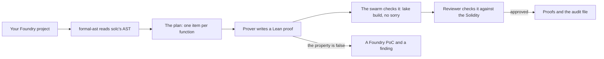

# Formal Mind

Formal Mind is a desktop app for auditing Solidity. A swarm of agents works through your contracts on your own
computer, one function at a time. It proves what each function does in Lean, and when a property turns out false, it
writes a Foundry test that shows the bug. Nothing leaves your folder except the model calls.

## What you get

- **Proofs.** Every function the deploy scripts reach gets a Lean theorem about what it does: when it reverts, what it
  writes, what it pays out. The Proofs page shows which functions are proved, function by function.
- **Statements.** Write a claim in plain words, like "only the owner can change the fee recipient". The swarm works
  out what it means in the code, asks you to confirm, then proves or disproves it.
- **Bugs.** A property that fails becomes a finding with a passing proof-of-concept test, filed in your audit
  folder. Audit reports you already have are listed and checked against the current code.
- **The Bug Hunter.** An agent that hunts on the compiled bytecode with coverage, concolic exploration and a
  debugger, and backs every bug with a test.
- **A report.** Formal Mind's assessment of the folder, in a standard JSON format and as a PDF.

## How it fits together

The agents read your contracts through the compiler's own syntax tree, not by grepping files. The Lean model each
proof is about is generated from that same tree, so a proof is about the code you wrote.

## Start here

1. [Install the app](/install) and sign in.
2. [Run it on a project](/first-run): add a Foundry project folder and start the swarm.
3. Read about [the swarm](/swarm), [Statements](/statements) and [the Proofs page](/proofs) to steer it.

Agents can read every page of this guide as Markdown: add `.md` to its address, or see
[llms.txt](https://docs.formal.team/llms.txt).
