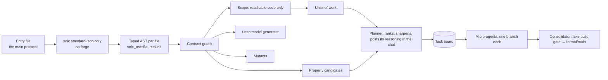

# The audit engine: AST first

**One rule: only the code counts.** No commit history, no comments, no docs as evidence. The engine reads the
Solidity compiler's AST, decides from it, splits work by it and generates from it. Agents never see raw AST. They see
small slices that the engine renders from it. The only place an agent reads code directly is inline assembly, and even
there the AST tells it which outside variables the assembly touches.

Formal proof in Lean 4 comes first. Mutation testing, invariant fuzzing and symbolic checks reuse the same graph
afterwards.

## 1. Pipeline

## 2. Reuse the language server (asyncswap/solidity-language-server)

**The AST comes from solc only, never forge.** We call `solc --standard-json` directly. The language server falls back
to `forge build --ast` when solc fails (`lsp.rs:819`); the engine does not. A solc error is reported as a compile error
with its message, and nothing is generated from a partial AST. Remappings come from `remappings.txt` and
`foundry.toml` read directly, not from `forge remappings`.

The crate is already a library (`src/lib.rs`). We use it for everything it already does well:

| Need | From the language server |
|---|---|
| The solc binary for the pragma, foundry.toml settings | `solc::resolve_solc_binary`, `config::FoundryConfig` (remappings read from the files, skipping the `forge remappings` step in `resolve_remappings`) |
| Compile the entry file's closure | `solc::discover_compilation_closure`, `build_batch_standard_json_input_with_cache`, `run_solc`, `normalize_solc_output` (mixed pragmas: `solc_project_index_from_files_ast_only`) |
| Stable file ids across compilations | `types::PathInterner`, `remap_src_canonical` |
| `src` parsing and locations | `types::SourceLoc` |
| Typed AST structs (calls, assignments, binary ops, Yul) | `solc_ast::{statements, expressions, yul}` |
| Storage slots | `storageLayout` → `build_storage_layout` |
| References, inheritance, call hierarchy | `references::all_references`, `linearized_base_contracts`, `call_hierarchy::{incoming,outgoing}_calls` |
| Per-file cache keyed by the file's keccak | `project_cache` (reference-index-v2 shards) |

**As built** (`crates/formal-ast`): the crate follows the language server's approach rather than linking it. The
server is async (tokio, tower-lsp, reqwest) and its index drops function bodies, which are exactly what the graph needs.
So `formal-ast` calls solc itself the same way: same output selection, `src` handling, and one pass before the AST is
dropped. On V4Vault the whole pipeline (compile, graph, scope, units) takes 0.33s. The graph is 297 KB of JSON,
against 3 MB of raw AST, and slices are 13–34 KB per unit. Cached shards keyed by file hash, following the language
server, come later.

What it doesn't have, which the new crate adds:
- **Function bodies.** The index strips `body`, `modifiers` and `linearizedBaseContracts` to stay small. We deserialize
  the full typed `SourceUnit` only for **in-scope** files, and only while building the graph, then drop it.
- **A visitor.** The crate's `AstVisitor` is test-only, so we write a typed one.
- **Reads/writes, call kinds and arithmetic sites.** These come from the visitor (section 3).
- **Assembly detail.** `externalReferences` with `isSlot`/`isOffset`, plus Yul `sload`/`sstore`/`tstore`/`call` in
  the assembly body.

Size discipline, following the language server: solc output can be about 20 MB of JSON for one test file. We consume
it once, keep slim tables, and cache them per file hash. Nothing large is held in memory or put in a prompt.

## 3. The contract graph

Built by one pass of the visitor over the in-scope files:

| Table | Contents | Source in the AST |
|---|---|---|
| `contracts` | name, kind, linearized bases, storage vars and slots | `ContractDefinition`, `storageLayout` |
| `functions` | visibility, mutability, modifiers (in order), params, returns, `src` | `FunctionDefinition`, `ModifierInvocation` |
| `footprint` | per function: state vars **read** and **written** (directly and through internal calls) | `Identifier`/`MemberAccess`/`IndexAccess` → `referencedDeclaration` is a state var; written when it's the left side of an `Assignment`, `++`/`--`, `delete`, or `.push`/`.pop` |
| `calls` | internal / external / library / low-level, the target, and whether it comes **before** a state write in the same path | `FunctionCall.kind`, the callee's `referencedDeclaration`, the type of the base expression, Yul `call` |
| `guards` | `require`/`revert`/`if-revert` conditions per function, plus modifier conditions | `FunctionCall(require)`, `RevertStatement`, modifier bodies |
| `arith` | each `+ - * / % **`, its types, checked or `unchecked`, divisions and mulDiv calls with rounding (Floor/Ceil) | `BinaryOperation`, `UncheckedBlock`, calls to known math libraries |
| `asm` | each assembly block, the outside vars it reads or writes, slot/offset use, opcodes used | `InlineAssembly.externalReferences`, the Yul AST |

**Scope.** Starting from the entry contract's public and external functions, follow internal calls and inheritance
transitively. Everything reached is in scope. Anything imported but never reached is listed as **unused**, a finding
in its own right, and otherwise ignored. That's how one entry file covers many files at once.

## 4. Units of work

The graph splits the protocol into **units**: one external entry point plus its internal call closure and its state
footprint. Units that write the same state variable form a **cluster**. Invariants live at the cluster level, and
lemmas about one function live at the unit level.

An agent receives a **slice** for its unit: the source text of the functions in the closure (cut out by `src`), the
footprint, the guards, the arithmetic sites, and the generated Lean definitions. That's a few KB instead of the whole
repository, and it's why the agents get faster.

## 5. The Lean model, generated

The generator turns the graph into Lean 4 the same way every time:

| Solidity | Lean |
|---|---|
| contract storage | `structure State` (mappings as functions, arrays as lists) |
| `uint256` / `intN` arithmetic | `UInt256` words with explicit checked (revert on overflow) or wrapping semantics, as the AST says |
| `mulDiv(a,b,c,Floor/Ceil)` | one shared `MulDiv` module with proven floor/ceil lemmas |
| a function | `def f (s : State) (env : Env) (args) : Except Revert (State × Ret)` |
| `require(c)` / modifiers | an early `Except.error` branch, in modifier order |
| an external call | an `opaque` oracle in `Env`, plus a flag in the assumptions list |
| assembly | the part the generator can't translate: an `opaque` stub with the vars it touches, which an agent must fill in |

The model is **faithful by construction**, and each generated definition carries the `src` it came from. The agents
write only **theorems and proofs**. Every proof reports the `opaque`s it depends on, and those dependencies are
the protocol's security assumptions.

## 6. What else the same graph provides

All of these come from the graph and need no model time:

- **Property candidates** (section 3 tables → theorems):
  - a var written by several units: an invariant over the cluster;
  - a division: a rounding-direction lemma;
  - an external call before a write: a reentrancy assumption;
  - guards on `msg.sender`: an access matrix;
  - paired units (deposit/redeem): round-trip, no free value;
  - sums against a balance: solvency.
- **Mutants**, by rewriting the AST at the `src` ranges:
  - flip a comparison, Floor ↔ Ceil, drop a guard, ±1 on a bound, swap the call/write order, `checked` ↔ `unchecked`.
  - A mutant that every proof and test still passes is a hole in the spec. Mutation score = spec strength.
- **Invariant fuzz harnesses**: the same properties as Foundry invariants, with handlers generated from the units.
- **Symbolic checks**: the same properties for Halmos, bounded.

## 7. Agents

| Agent | Input | Output |
|---|---|---|
| Planner | the graph summary (tables, not source), candidates | the ranked theorem list in the chat, with its reasoning shown; tasks on the board |
| Prover (micro) | one unit's slice + one theorem + its notes | a proof on its own `formal/t-<n>` branch, or a stuck goal + notes, time-boxed |
| Assembly reader | one `asm` block + its references | the Lean stub filled in, with assumptions |
| PoC writer | a counterexample or a stuck goal that looks false | a Foundry test that fails for the stated reason |
| Reviewer | a theorem statement + slice | "says what the code means" or a correction; it doesn't check proofs, Lean does |
| Consolidator | finished branches | merges into `formal/main` behind `lake build`, dedupes lemmas, keeps the report current |

They run on the session state machine (`SWARM-STATES.md`): Working means N micro-agents pulling from the board.
Priority = value ÷ cost, every task has a time box, and a stuck task is split or set aside with notes.

## 8. Build order

1. `formal-ast` crate, using the language server: compile the entry file, build the visitor and graph tables, compute
   scope and units, render slices. A CLI: `formal-ast graph <entry.sol>`, `slice <fn>`, `units`.
2. The Lean generator for the subset vaults and lending use: storage, functions, guards, checked/unchecked uint, mulDiv;
   external calls opaque.
3. Benchmark on V4Vault (Revert v4lend): time to the generated model, time to first theorem, proofs per dollar,
   compared with the hand-written proofs from the earlier run.
4. Agent tools in the swarm (`ast_units`, `ast_slice`, `lean_model`), planner and micro-provers on branches, and the
   consolidator.
5. Mutants and the mutation score, then fuzz and symbolic harnesses from the same properties.
