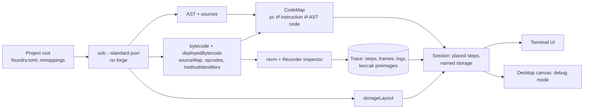

# The debugger: every opcode in its AST node

**Same rule as the audit engine: only the code counts.** The debugger reads what solc produced: the AST, the bytecode,
the source maps between them and the storage layout. It runs that bytecode in an embedded EVM and shows, for every
step, the Solidity line and AST node it came from, the stack, memory, the storage it touched (named like `accounts[0x5e…].shares`,
not just a slot hash) and the calldata of every call. Its job in Formal Mind is to make a fuzz counterexample, a
surviving mutant or a reported bug visible, one step at a time.

The prototype is `crates/sol-debug` (next to `crates/formal-ast`, whose solc project reading it reuses). It compiles
with solc standard-json (never forge), deploys into revm, runs one call and prints the trace below. The tests
(`crates/sol-debug/tests/deposit_test.rs`) check the source lines and named storage writes of `Vault.deposit(100)` from
formal-ast's fixture, and the map in both directions.

```
$ sol-debug crates/formal-ast/tests/fixture src/Vault.sol --contract Vault \
    --stub 0x00000000000000000000000000000000000000aa=2000000000000000000 \
    --set oracle=0x00000000000000000000000000000000000000aa --call deposit --arg 100 --lines
── CALL 0x5e5E…5E5e → 0x4644…BD2E deposit(100)
   …
   161 Vault.sol:56   Vault.deposit  pc=1433  SLOAD    [5, 0, 0xde0b6b3a7640000]  │ uint256 shares = assets.mulDiv(1e18, oracle.price());  ⟶ read oracle = 0x…00AA
  ── STATICCALL 0x4644…BD2E → 0x0000…00AA 0xa035b1fe…
   193   <no source>                pc=0     PUSH32   []
   308 MathLib.sol:9  MathLib.mulDiv pc=1780 JUMPDEST [0x1bc16d674ec80000, 0xde0b6b3a7640000, 100]  │ function mulDiv(…)
   530 Vault.sol:63   Vault._credit  pc=1837  SSTORE  [0xd6d8b5…7fd7, 50, 50]  │ acc.shares += shares;  ⟶ write accounts[0x5e5E…5E5e].shares: 0 → 50
   604 Vault.sol:58   Vault.deposit  pc=1621  SSTORE  [1, 100, 100]            │ total += assets;  ⟶ write total: 0 → 100
   616 Vault.sol:59   Vault.deposit  pc=1635  SSTORE  [3, 1, 1]                │ history.push(assets);  ⟶ write history.length: 0 → 1
   639 Vault.sol:59   Vault.deposit  pc=1660  SSTORE  [0xc2575a…f85b, 100, 50] │ history.push(assets);  ⟶ write history[0]: 0 → 100
ok: 646 steps, 116427 gas
```

**Running a project's own tests.** `sol-debug <root> test/AsyncSwap.t.sol --contract AsyncSwapTest --test
test_swap_createsOrderWithPrice --tui` deploys the test contract, runs `setUp()` untraced, and records the test:
32,902 steps through Router → PoolManager → the AsyncSwap hook → DELEGATECALLs into its libraries, in about 30 ms
after a 2 s compile. To get there the session:

- answers forge's common cheatcodes itself (`cheats.rs`): prank, deal, etch, getCode (and so `deployCodeTo`), warp,
  roll, addr, sign, label, assume, expectRevert and the assert* family. There's a one-byte stub at the `vm` address
  for Solidity's extcodesize check. An unsupported cheatcode reverts with its selector, so it shows in the trace at
  the step that needed it;
- deploys and links external libraries the way forge does;
- recognises code by its bytes, not by who deployed it: each frame records the hash of the code it ran, matched
  against solc's init and runtime code with immutables, library addresses and a library's own address masked. So
  code etched by `deployCodeTo` or created by `new` in setUp is still placed in the source;
- reads remappings like forge: `v4-core/=dependencies/v4-core/src` gets its trailing slash, and a dependency's own
  `remappings.txt` is scoped to it (`dependencies/v4-core/:solmate/=…`). This lives in formal-ast's `Project`, so
  the audit engine benefits too.

The terminal UI (`tui.rs`, section 8) and the step-in/over/out logic (`nav.rs`, section 6) are built.

## 1. Pipeline



The recorder knows only the EVM. Everything Solidity (lines, nodes, variable names) is added afterwards from the
compile output. A trace can then be re-read against a different build of the same code. It can also come from
somewhere other than revm, such as a node's `debug_traceTransaction`.

## 2. Source maps (bytecode ⇄ AST)

### What solc gives

`solc::compile` (`crates/sol-debug/src/solc.rs`) asks standard-json for:

| Output | Used for |
|---|---|
| `evm.bytecode.object`, `evm.bytecode.sourceMap` | Init code and its map (constructor steps) |
| `evm.deployedBytecode.object`, `.sourceMap` | Runtime code and its map |
| `evm.deployedBytecode.opcodes` | Disassembly cross-check (we walk the bytes ourselves) |
| `evm.methodIdentifiers` | Selector ⇄ signature: naming calls, encoding `--call deposit` |
| `storageLayout` | Naming slots |
| `ast` (per source) | Nodes, their `src`, the function a step is in |

The optimizer is off, so the maps are precise to the expression. An optimized build also maps, only more coarsely, and
the debugger should say so when it is on. The next output to add is `evm.deployedBytecode.generatedSources`. These are
the Yul utility functions (`checked_add_t_uint256`, ABI decoders) that show as `<no source>` today. They have their
own source ids, so the same machinery maps them to Yul lines.

### Decoding the compressed map (`srcmap.rs`)

The map is `;`-separated, one entry per **instruction** (not per byte): `s:l:f:j:m`, where

- `s`: byte offset into the source,
- `l`: length in bytes,
- `f`: source id (`sources.<path>.id`), or -1 for code the compiler generated,
- `j`: `i` (jump into a function), `o` (jump out of one) or `-`,
- `m`: modifier depth.

Empty fields repeat the previous entry's value (`;;` repeats a whole entry). `decode` expands the map to a
`Vec<SrcEntry>`. Separately, `pc_to_index` walks the bytecode, where `PUSHn` takes 1 + n bytes but one entry, to build
pc → instruction index. The CBOR metadata at the end of the code walks as garbage instructions that have no entries,
which is harmless.

### pc → AST node, and back (`CodeMap`)

`source.rs` indexes every AST node with a `src` per file, sorted by start. For an instruction's `(s, l, f)`, the node is
the **innermost node whose range covers it**. That is usually an exact match: solc emits the `src` of the expression it
is compiling. Each node also records its enclosing contract, function or modifier, which gives the `Vault._credit`
column.

The prototype builds the map in both directions, once per piece of code:

| Direction | API | Use |
|---|---|---|
| bytecode → AST | `CodeMap::at_pc(pc) → (SrcEntry, node)` | Each trace step's line and node; "where did this revert come from" |
| AST → bytecode | `CodeMap::pcs_for_node(node)`: every pc whose `src` lies inside the node | Breakpoints on a function or expression, coverage per node, mutation targets |
| line → bytecode | `CodeMap::pcs_for_line(file, line)` | `:b 58` |

`sol-debug --map-line 58` and `--map-pc 1621` print each direction:

```
src/Vault.sol:58  total += assets;           pc=1621 SSTORE → src/Vault.sol:58 Assignment #130 in Vault.deposit
  pc=1599   DUP3     Identifier #129            total += assets;
  pc=1600   PUSH1    Identifier #128            the node compiles to 19 instructions
  pc=1603   DUP3     Assignment #130
  …
  pc=1621   SSTORE   Assignment #130
```

The test `bytecode_to_ast_and_back` checks the round trip: the `total` SSTORE maps to the `total += assets`
Assignment, that node's pcs include the SSTORE, and every one of its pcs maps back inside it.

### From bytecode alone (no source in hand)

Both directions above assume we compiled the code ourselves. Going from a deployed contract's bytecode to an AST takes
one more step, in increasing order of difficulty:

1. **Recompile from the metadata (exact).** solc appends CBOR metadata to the runtime code: an IPFS or Swarm hash of
   `metadata.json`, plus the solc version. The metadata file pins the compiler, its settings and the keccak of every
   source file. With the sources (from Sourcify, an explorer's verified code, or the project folder), we recompile with
   identical settings, check that the bytecode matches (ignoring immutables), and then have the full map above for
   code we never built. This is how the debugger should open any on-chain address.
2. **Match against known builds.** Without the sources, the metadata still names the compiler version. Library code
   (OpenZeppelin, solmate) compiles to recognizable instruction sequences per version and settings. We fingerprint
   basic blocks of known library functions and attach their ASTs where they match.
3. **Lift (approximate).** For the rest: disassemble, rebuild the control-flow graph (the `j: i/o` markers show what
   solc's function calls look like), lift to a Yul-like IR, and recognize solc's own patterns (the dispatcher,
   `checked_add_*`, mapping slot hashing, `abi_decode_*`) to recover functions, storage variables and mappings. The
   result is an AST we infer rather than one solc wrote. The UI has to show it differently and never present it as source.

Step 1 is a small, well-defined job and goes first. Steps 2 and 3 are research. The useful property is that the
debugger's input is "code plus a CodeMap", so all three plug in the same way.

## 3. Execution (`trace.rs`)

revm 43 is embedded. `Session` keeps one in-memory chain (`CacheDB<EmptyDB>`, nonce checks off). Contracts are
deployed by running their init code, so constructor steps are traced too. Each transaction runs with the `Recorder`
inspector:

| Hook | Records |
|---|---|
| `step` | pc, op, full stack, gas left, memory size, which code (runtime of an address, or init code), the storage owner (frame target; differs from the code under DELEGATECALL) |
| `step` on `SSTORE` | slot, new value, old value (last value seen this tx, else the DB's committed value) |
| `step` on `KECCAK256` | the hashed bytes: **preimages**, used to name mapping and array slots |
| `step_end` | the op's result (stack top), and the value for `SLOAD` |
| next `step` in the same frame | memory writes of the previous step, as changed 32-byte words. This also catches a CALL's return data landing in the caller's memory |
| `call` / `create` (+ `_end`) | frames: kind, caller, target, code address, value, **calldata**, success, return data |
| `log_full` | events, with the step that emitted them |

Memory is snapshotted per step and diffed by word. That is fine for single transactions, which use kilobytes of memory.
For long fuzz sequences, keep the diffs and drop the snapshots, and rebuild any step's memory by replaying diffs from
the frame start (with a checkpoint every N steps). revm-inspectors' `TracingInspector` records similar data, but it
records full stack and memory snapshots per step. Our own recorder stays smaller and keeps the preimages it needs.

Known gaps in the prototype: old values ignore reverted sub-frames, libraries that need linking are refused,
transient storage (`TSTORE`/`TLOAD`) isn't named yet, and only one compile unit is loaded per session.

## 4. Lookup: a step in Solidity

`Session::locate(code, pc)` picks the artifact deployed at the step's code address (or the init code being
deployed) and looks the pc up in its `CodeMap`. The result is the source entry, file, line, innermost node, node type
and `Contract.function` scope. Steps in code we didn't compile (the oracle stub above) and compiler-generated
instructions (`f = -1`) have no place. The UI shows them as `<no source>` and folds them by default.

## 5. Views

| View | Contents |
|---|---|
| Source | The file at the current line. The current node's `src` range is highlighted, not just the line, because one line often holds several nodes (`assets.mulDiv(1e18, oracle.price())`). |
| Opcodes | A window of instructions around the pc, each with its AST node type; the ones from the current node are highlighted |
| Stack | Top first, with words that look like addresses, selectors or known slots labeled |
| Memory | Hex and ASCII by word, with words this step wrote highlighted; the free memory pointer (`0x40`) labeled |
| Storage | By variable name and slot, from the layout: values seen or written so far, with old → new |
| Calldata / return data | Per frame, decoded with the ABI of the code at that address |
| Calls | The frame tree: kind, from → to, decoded call, success, gas |
| Events | Decoded with the ABI |

### Naming storage (`layout.rs`)

`storageLayout` gives each root variable a slot, an offset (packed variables share a slot) and a type. Its `types` table
gives sizes, struct members, array bases, and mapping keys and values. Naming a slot:

1. **Root variables and what's inside them:** a slot equal to a variable's slot, or within its span (a struct member,
   a fixed array element). Every variable packed into the slot is listed with its byte offset, so one SSTORE to a
   packed slot shows each variable that changed.
2. **Mappings:** `m[k]` lives at `keccak(k ‖ p)`, where `p` is the mapping's slot. A hash can't be reversed, so the
   recorder keeps every KECCAK256 input. A slot `s` is named by finding a recorded hash `h ≤ s` with a small offset
   `s − h` (a struct member), splitting that hash's input into key and base slot, naming the base slot recursively,
   and checking that it is a mapping. That gives `accounts[0x5e…].shares`. String and bytes keys work the same way:
   the key is everything before the last 32 bytes.
3. **Dynamic arrays:** the length is at `p`, element `i` at `keccak(p) + i × slots(element)`. Packed elements show the
   index range in that slot.

This handles any nesting (`a[k1][k2].xs[3]`), because names are built from the bottom up. A slot that a contract
computed without hashing in this run, such as a value read from storage in an earlier transaction, has no preimage
yet. The prototype keeps preimages per transaction. Next, the session should keep them across transactions and also
hash candidate keys it has seen (callers, addresses and values in calldata) against each mapping's slot.

## 6. Navigation

Everything runs over the recorded trace. Each command is a search in the step array, so stepping backwards costs the
same as stepping forwards.

| Level | Forward | Back | How |
|---|---|---|---|
| Opcode | `s` step | `S` | ±1 step |
| Solidity step | `n` next line | `N` | Next step at the same call depth (counting `j:i`/`j:o` jumps and frames) whose location is on a different line or node |
| Into | `s` on a line with a call | | The first step after a `j:i` jump, or the first step of a new frame |
| Out | `f` finish | `F` | The step after the matching `j:o` jump or frame end |
| Continue | `c` | `C` | To the next or previous breakpoint |

Internal calls have no frames in the EVM. They are jumps, and the source map's `j` field marks them: `i` enters a
function, `o` leaves one. The session keeps a virtual call stack from those markers (checked against the AST: the
jump's target should land on a `FunctionDefinition`), so "step over `_credit(acc, shares)`" works like a real call.

**Breakpoints:**

- a line (`:b 58`): the pcs from `pcs_for_line`,
- a function (`:b Vault._credit`): its entry pcs from `pcs_for_node`,
- an AST node (`:b #130`),
- a storage write (`:w total`, `:w accounts[*].shares`): steps whose named writes match,
- a revert (`:b revert`),
- a call to an address or selector.

## 7. Agent hooks: replaying counterexamples

The swarm's fuzzers and mutation runs produce **call sequences**. The debugger takes one as JSON:

```json
{
  "project": "crates/formal-ast/tests/fixture", "entry": "src/Vault.sol", "contract": "Vault",
  "setup": { "stubs": { "0x…aa": "2000000000000000000" }, "set": { "oracle": "0x…aa" } },
  "calls": [
    { "from": "0x…5e", "fn": "deposit(uint256)", "args": ["100"] },
    { "from": "0x…5e", "fn": "withdraw(uint256)", "args": ["50"] }
  ],
  "expect": { "invariant": "total == sum(accounts[*].shares * price)", "failed_at": 1 },
  "mutant": { "node": 130, "replace": "total -= assets" }
}
```

- **Fuzz counterexample:** replay the calls in one session. The debugger opens at the first step where the invariant
  breaks. Invariants are written over named storage, so the session evaluates them on its own decoded state after
  every call.
- **Mutation:** a mutant is an AST node id plus a replacement. Apply it to the source, recompile, and run the same
  sequence on the original and the mutant side by side. The **first divergent step** (by pc, node, stack or storage) is
  where the debugger opens. Because the map goes both ways, the diff is shown on the AST node, not just the opcode.
- **Findings:** an agent's proof of concept (a call sequence) is attached to a finding, and the finding's link opens
  the debugger at the step that shows the bug.
- **Coverage for agents:** `pcs_for_node` over all traced steps gives per-node coverage. The planner uses it to see
  which branches a fuzzer never reached.

## 7a. Differential equivalence: a protocol and its port

Async Swap exists twice: Solidity (`asyncswap/contracts`) and a Huff port (`asyncswap/v2-raff`, compiled by `hnc`)
that passes the Solidity repo's own test suite. Passing the same assertions is a weak check: the suite only asserts
what its authors thought to assert. The diff compares everything an outside observer can see, on every step of the
same test:

```
$ sol-debug ~/developer/asyncswap/contracts test/AsyncSwap.t.sol --contract AsyncSwapTest \
    --test test_swap_createsOrderWithPrice --diff ~/developer/asyncswap/v2-raff
AsyncSwapTest::test_swap_createsOrderWithPrice   contracts: pass (32902 steps)   v2-raff: pass (13116 steps)

✓ calls                        18 matched   (contracts 18, v2-raff 18)
✓ events                       6 matched   (contracts 6, v2-raff 6)
✓ storage token0               3 matched   (contracts 3, v2-raff 3)
✓ storage PoolManager          1 matched   (contracts 1, v2-raff 1)
· storage AsyncSwap            not compared: layouts differ (contracts 24 writes, v2-raff 16); pass --slot-map …
```

Add `--tui` for a split view (one run above the other) opened at the first divergence. Tab switches which run the
keys move; `=` returns both to the divergence. The exit code is 1 when the runs diverge, so the diff can gate CI.

**What is compared** (`crates/sol-debug/src/diff.rs`):

| Observation | Compared as |
|---|---|
| External calls | Kind, caller, target, value, calldata, success, return data, in order. Not compared: DELEGATECALLs into libraries (the port inlines them), cheatcode calls, console.log. A CREATE is compared by which contract it builds plus its constructor arguments, because the same contract compiled in two projects has a different metadata hash. |
| Events | Address, topics, data, in order |
| Storage | Per contract, named writes in order, for contracts both sides run the same solc code for (PoolManager, tokens). For the ported contracts, only with a slot map (below); otherwise counted |

**Making two runs comparable.**
- Addresses: a contract can sit at different addresses on the two sides (the Huff Router is deployed at another
  nonce). Contracts are paired by name first (`Router` ↔ `Router.huff`, labels like `token0`), then by position as
  the call trees are walked. Every address is compared through its pair.
- Hashes: a slot like `positions[keccak(owner, ticks, salt)]` hashes in a paired address, so the hash itself
  differs. A 32-byte word whose keccak input the trace recorded is compared by that input, recursively, through the
  same address pairing.

**Running the port.** The Huff tests compile with `vm.tryFfi(["hnc", file, "-b", …])`. `ffi` runs only allowlisted
programs (`hnc`), in the project root, and is cached per argv. Code that solc didn't build is named by the `hnc`
output it came from (`AsyncSwap.huff`): a runtime's first 64 bytes are found in that creation code, because a
constructor may append immutables. Huff frames get function names from the Solidity interfaces' selectors
(`Session::selectors` covers every compiled contract and interface).

**The ported contracts' own storage.** The Huff port keeps its own layout: `OWNER_SLOT = 0x00`, hashed slots for
transient flags, the radix tree at `0x800`. `--slot-map map.json` names the other side's slots with a solc-format
`storageLayout` per contract name (`{"AsyncSwap": {"storage": [...], "types": {...}}}`). Then those writes are compared
by name like the shared contracts' writes. This works when the port derives mapping and array slots the way Solidity
does. A layout that hashes differently (packed keys, other orders) needs its own naming rule, which is the next step
here.

**What it found.** Across `AsyncSwap.t.sol`, the first sweep reported false divergences: CREATE metadata hashes,
addresses only seen in calldata, and hashed slots keyed by those addresses. Each became a rule above. After them,
all 28 tests in `AsyncSwap.t.sol` show the Solidity and Huff builds agreeing on every external call, event
and shared-contract write. The hook's internal storage isn't compared yet, because that needs the Huff slot map.

**Further levels.**
1. Equivalence over many inputs: the same comparison over fuzzed and recorded call sequences (the agent-hook format
   in section 7). Every invariant campaign becomes an equivalence campaign.
2. Per-selector symbolic equivalence: for each function, both bytecodes give the same storage, return data and logs
   for all inputs (hevm's `equivalence` mode compares two bytecodes). Differential traces are what make a failed
   proof readable.
3. Lean: one model of the protocol, with both implementations shown to refine it.

## 8. UI plan

### Terminal first (ratatui)

`sol-debug tui <project> <entry> --replay seq.json`: panes for source, opcodes, stack, memory, storage and calls, with
vim keys:

| Key | Action |
|---|---|
| `h j k l` | Move focus and scroll within a pane |
| `s` / `S` | Step one opcode forward / back |
| `n` / `N` | Next / previous Solidity line at this depth |
| `f` / `F` | Finish this function / go back to its call |
| `c` / `C` | Continue to the next / previous breakpoint |
| `gg` / `G` | First / last step |
| `/text` | Search the source, op names or storage names; `n` jumps to the next match while searching |
| `:b 58`, `:b Vault._credit`, `:w total` | Breakpoints |
| `:pc 1621`, `:node 130` | Jump to the step for a pc or AST node |
| `:call 2` | Jump to a frame |
| `:q` | Quit |

The engine (`Session`, `Trace`, `CodeMap`, `Layout`) has no UI code, so the TUI is a separate binary target on the
same library.

### Desktop: debug mode on the canvas

The Tauri app runs the same crate through a command (`debug_open(seq) → session id`, `debug_step(id, cmd) → view`).
The canvas gets a debug mode: the contract graph that formal-ast already draws, with the current function lit, an edge
animating for each call frame, storage cells changing as the trace advances, and a timeline scrubber over the steps
(reverse stepping is free, since it's an index). A finding or a failing fuzz run on the canvas has an "Open in
debugger" action.

## 9. Reuse

| Tool | What it is | What we take |
|---|---|---|
| **solc's own outputs** | `sourceMap`, `generatedSources`, `--debug-info` (Yul/asm location comments), `evm.legacyAssembly` | All of the mapping. `generatedSources` is next, to name the `<no source>` helper steps. |
| **foundry's debugger** (`forge test --debug`, `crates/debugger`; `forge debug` was folded into it) | ratatui TUI over a per-step debug arena from foundry-evm, source maps through foundry-compilers | The TUI layout and key ideas, its handling of `j` markers and its pc→ic maps. Not the crate: it is tied to forge's build pipeline and artifacts, and we compile with solc only. MIT/Apache, so pieces can be lifted with attribution. |
| **hevm** | Haskell EVM with a symbolic engine and an older TUI debugger | Ideas only: symbolic stepping and showing path conditions next to the stack. Later, symbolic counterexamples (from hevm or our own checks) are just another call sequence to replay. |
| **revm inspectors** (`revm-inspectors`: `TracingInspector`, call traces, `TracerEip3155`) | Standard tracers on revm | EIP-3155 output for cross-checking our steps against other EVMs. `TracingInspector`'s call-tree printer for the calls view. Our own recorder stays, for the preimages and old values. |
| **solidity-language-server** (asyncswap) | Our Rust LSP over solc ASTs | `src` parsing and caching, byte/UTF-16 position conversion for the editor view, go-to-definition from a step's node to its declaration |
| **formal-ast** | Contract graph, scope, units | The project reading and solc binary resolution (already used). Next: the graph for the canvas, and each unit's reads and writes, to predict which storage a step should touch. |

## 10. Next steps

1. `generatedSources` to place the compiler helper steps.
2. Replaying call sequences from JSON (the agent hook), with an invariant checked after each call.
3. Tests picked from the file tree: in Formal Mind, the user selects a local repository, sees its files, and starts
   analysis or debugging from there. `Session::compile(root, file)` already takes a project folder and one file.
   The desktop app passes the selected folder and the clicked test file, then lists the `test_…` functions to run.
4. Recompiling from on-chain metadata, to debug deployed contracts.
5. The Tauri debug mode on the canvas, on the same `Session` + `Navigator`.
