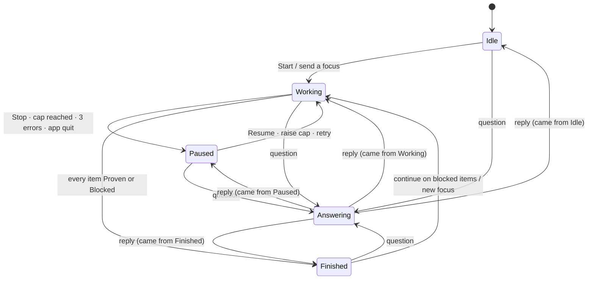
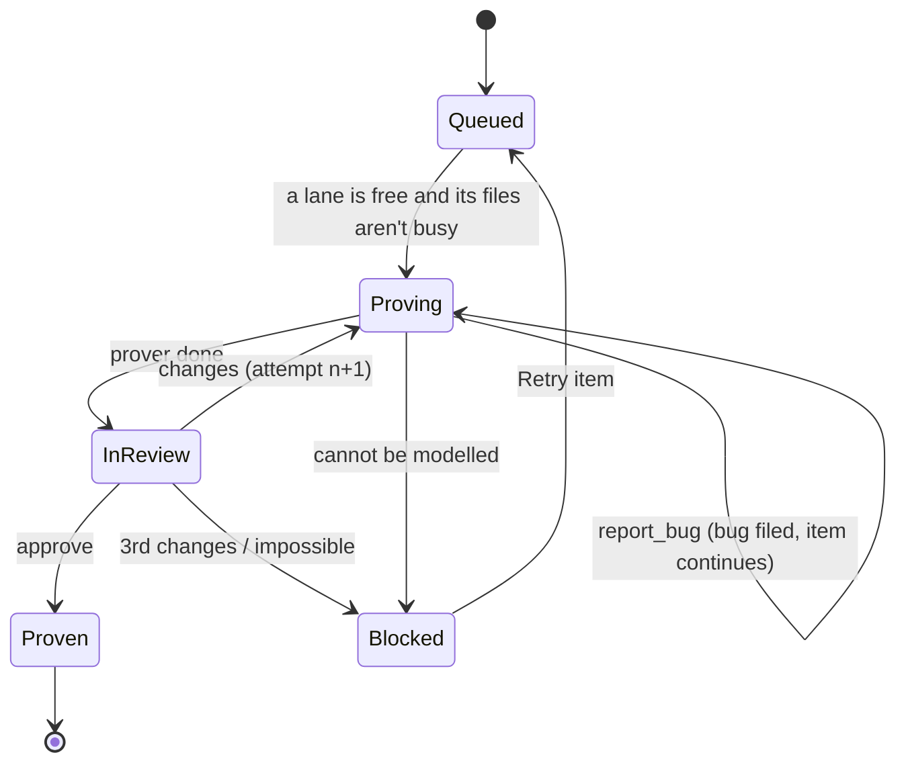

# Local swarm: one state machine

Today a folder's page derives its state from several places: a `run` id, a `viewing` session, `events`, the queue
file, `finished`, the budget dropdown and the canvas board. Each one guesses what is going on. This replaces them with
one machine per **session**, owned by Rust, that the chat, the canvas, the sidebar and the header all render.

## Words

- **Folder**: a local repo you added. It has **sessions**, and `main` is the default.
- **Session**: one plan, one queue, one spend total and one chat. You add more with +.
- **Job**: one unit of agent work on one plan item: `plan`, `prove`, `review` or `answer`.
- **Item**: one line of `.formal/plan.md`.

## The session machine (Rust is the source of truth)

| State | What runs | What the UI shows |
|---|---|---|
| Idle | nothing | composer: "What should it focus on?"; Start |
| Working | 1 to N jobs (see lanes) | lanes on the canvas, live trace in the chat; Stop; cap menu |
| Answering | one answer job (a cheap model, read-only tools) | a reply in the chat; the canvas unchanged |
| Paused | nothing; jobs saved mid-step | the reason in one line, and the one action that fixes it (Resume / Raise cap / Retry) |
| Finished | nothing | summary: proven, blocked (with reasons), bugs; "Continue on blocked items" |

Rules:
- **Questions never restart the pipeline.** Answering returns to the state it came from: an answer while Paused leaves
  it Paused.
- **The spend cap is checked before every model call**, not between jobs. Reaching it moves to `Paused(cap)` with the
  conversation saved. There is one spend number per session (in the queue file), and every view shows that number.
- **Network or overload errors retry** with backoff, three times, before moving to `Paused(error)`.
- **Quitting the app** moves to `Paused(quit)`, and the next launch offers Resume.

## Lanes inside Working (for performance)

Working runs **lanes** in parallel. A lane is one agent on one item:

- Up to `lanes` provers at once (2 by default, set in Settings). Items that touch the same contract files wait for each
  other; different contracts run side by side.
- A reviewer picks up any item in `InReview` as soon as it lands, so it never waits for the next prover.
- The planner runs once at the start, then again only when every item is `Proven` or `Blocked`.

## Notes per item (fewer tool calls, better bugs)

Each item keeps `.formal/notes/<n>.md`: files and line ranges read, the model, the open goals, reviewer requests, and
why it is blocked. Every attempt starts with these notes in the prompt instead of rereading the sources, which
accounts for most of the 258 calls in the v4lend run.

## Models per role (cost)

| Role | Default | Why |
|---|---|---|
| planner | Opus | sets the whole run's direction |
| prover | Opus (Sonnet on attempt 1 if the cap is tight) | the hard part |
| reviewer | Sonnet | checks against the source, so it doesn't need to search |
| answer, draft reply, titles | a low-tier model (Haiku, or GPT-6.1 Luna through formal.team) | short and read-only |

GPT-6.1 Luna needs the desktop proxy to route non-Anthropic models. That's a server change in `lib/model-gateway.ts`, and it waits until the machine is in.

## The UI renders the machine

One `useSession(folder, session)` hook subscribes to Rust's `session` events and returns
`{ state, reason, items, lanes, spend, cap, chat }`. Every surface reads from it and nothing else:

| Surface | Reads |
|---|---|
| Sidebar session row | `state`: a dot for Working, a pause mark for Paused, a check for Finished |
| Chat header | title, `spend / cap`, Stop or Resume (by `state`) |
| Chat | `chat` (messages, traces), plus a one-line state banner when Paused or Finished |
| Composer | placeholder and send action by `state` (focus when Idle, steer when Working, ask otherwise) |
| Canvas | `items` as cards in columns (Queued, Proving, In review, Proven, Blocked), `lanes` as cursors |
| Floating cards | plan = `items`, bugs, files |

The UI keeps only its own state (which card is open, scroll position, the composer draft). Everything else comes from
the machine.

## Order of work

1. Rust: the session machine, the spend check before each call, retries, the Answering path. Emit one `session` event
   with the whole snapshot.
2. UI: `useSession`, and switch the chat, header, composer, sidebar and canvas over to it. Remove `run`, `viewing` and
   `finished` from the panel.
3. Lanes and parallel review.
4. Notes per item, models per role, and the low-tier model through the proxy.
