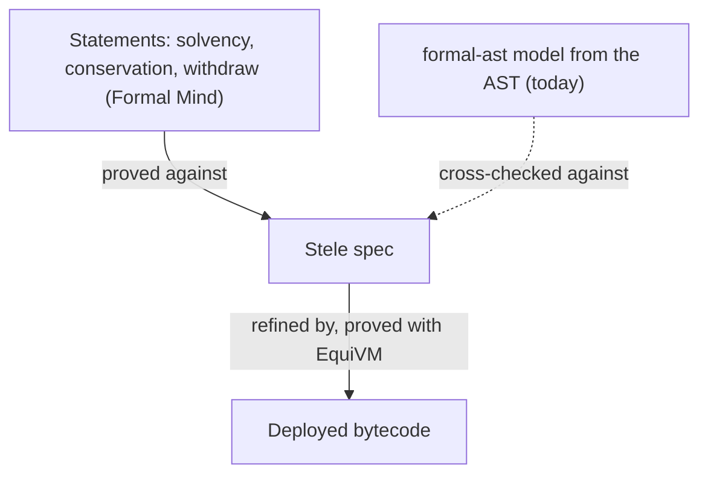

# Bytecode refinement with EquiVM

Formal Mind proves what a contract does against a Lean model that formal-ast builds from solc's AST. That leaves the
compiler trusted: our WETH9 audit says so in its scope. EquiVM ([argotorg/EquiVM](https://github.com/argotorg/EquiVM),
MIT; the paper is "Foundational Refinement Proofs for EVM Bytecode, at the Price of Tokens", Lazaropoulos and
Paraskevopoulou, arXiv 2607.26306) closes that gap: it proves that deployed bytecode refines a spec written in Stele,
a Solidity-like language with a formal semantics, on an executable EVM model that passes the Ethereum conformance
tests. Agents write the proofs; the paper reports 35 production contracts, among them WETH9, Morpho Blue, Safe,
Comet and Uniswap v3 and v4.

We build on EquiVM, not beside it: it is the bytecode layer, and Formal Mind stays the loop around it (the plan, the
statements, the swarm, the ledger, the review, the MCP, publishing).

## Steps

1. **Run EquiVM in the app.** A folder gets a `[bytecode]` section in `formalmind.toml` naming an EquiVM checkout
   (pinned commit) and the contract's artifacts (`creation.hex`, `runtime.hex`, ABI, solc version and flags). The app
   compiles the contract the way it is deployed and runs EquiVM's scaffold (`scripts/scaffold.py`,
   `scripts/sol2stele.py`, `scripts/proof_skeleton.py`). EquiVM pins its own Lean (v4.29), so it stays a separate Lake
   project.
2. **Refinement as plan items.** One item per function: prove the bytecode of that function's dispatcher arm refines
   its Stele transition, with EquiVM's prompt (`Misc/prompt.md`) as the prover's skill on top of ours. The swarm
   keeps its loop (prove, `lake build`, review); the reviewer checks the Stele spec against the Solidity. The ledger
   records `contractRefinement` per contract and each function's theorem.
3. **Test the spec against the bytecode before proving.** EquiVM's differential tests run the spec and the bytecode on
   random calls; we add our own runner (anvil, the Bug Hunter) and file each disagreement as a finding. In the paper
   this is where most spec mistakes, the checks solc inserts, and a known compiler bug surfaced.
4. **Statements on the Stele spec.** Formal Mind's statements (invariants, conservation, sequences) are proved against
   the Stele spec, so with refinement they hold for the bytecode. EquiVM's `Proofs/` already shows the ERC20 invariant
   that total supply equals the sum of balances this way.
5. **Repair across commits.** When the source or the compiler settings change, the swarm repairs the refinement proof
   from the previous one (the paper: under two hours per Safe commit against eighteen for the first proof).

## First targets

- **WETH9.** EquiVM's `Benchmarks/WETH9` proves the canonical source (solc 0.5.16, optimizer 200 runs). Link our seven
  WETH9 statements to it: prove them against its Stele spec.
- **Morpho Blue.** Also an EquiVM benchmark (byte-identical to mainnet); our Morpho Blue swarm proved 2 of 37 against
  the AST model.

## Spike: EquiVM's WETH9 on this machine (2026-10-27)

- `lake build Benchmarks.WETH9.Correct` at EquiVM `main` builds in about five minutes (3,515 jobs, Lean v4.29.0,
  Mathlib from the cache).
- The capstone is `Benchmarks.WETH9.weth9ContractCorrect : contractRefinementWF weth9StorageWF noGasBound config
  weth9CreationBytecode contract`. Its side condition `weth9StorageWF` bounds the length of the stored `name` and
  `symbol` strings when they are returned; `noGasBound` means no gas bound is assumed.
- It rests on Lean's three standard axioms and on 2,611 `native_decide` axioms: concrete facts (decoding, storage
  slots) checked by Lean's compiled evaluator, which EquiVM documents as part of its trusted base. Formal Mind's own
  rule refuses `native_decide`, so the ledger can't count these proofs as they are. Either the bytecode layer accepts
  `native_decide` as a stated part of its trusted base, or those facts are re-proved with `decide` (slower to check).

## Open questions

- Accept `native_decide` in the bytecode layer, stated in the audit's trusted base, or require `decide`?

- Keep the formal-ast model as the fast first pass, and refinement as the stronger layer? Or move statements to Stele
  outright?
- Lean versions: EquiVM is on v4.29, our projects on v4.35. Two Lake projects per folder, or follow EquiVM's pin.
- Talk to the authors (the paper's contact is the corresponding author, Zoe Paraskevopoulou) about upstreaming our
  statements and the swarm loop as an EquiVM front end.
