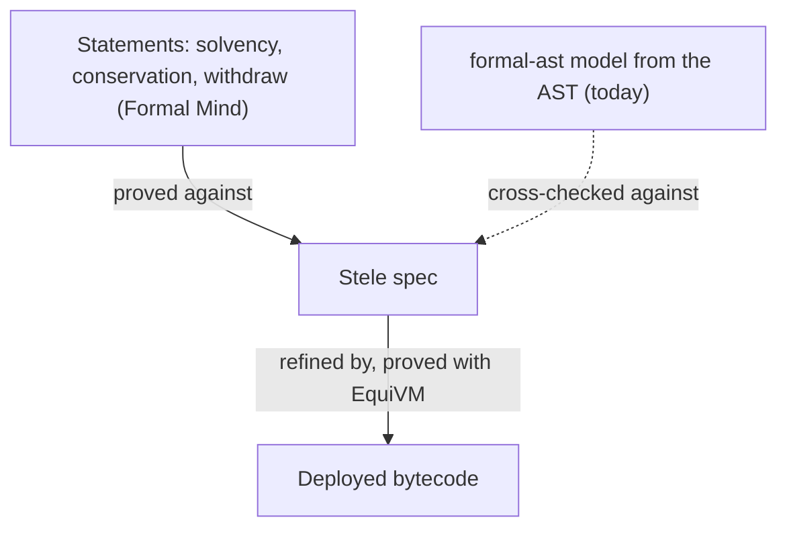
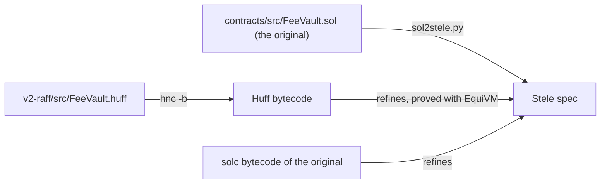

# Bytecode refinement with EquiVM

Formal Mind proves what a contract does against a Lean model that formal-ast builds from solc's AST. That leaves the
compiler trusted: our WETH9 audit says so in its scope. EquiVM ([argotorg/EquiVM](https://github.com/argotorg/EquiVM),
MIT; the paper is "Foundational Refinement Proofs for EVM Bytecode, at the Price of Tokens", Lazaropoulos and
Paraskevopoulou, arXiv 2607.26306) closes that gap: it proves that deployed bytecode refines a spec written in Stele,
a Solidity-like language with a formal semantics, on an executable EVM model that passes the Ethereum conformance
tests. Agents write the proofs; the paper reports 35 production contracts, among them WETH9, Morpho Blue, Safe,
Comet and Uniswap v3 and v4.

We build on EquiVM, not beside it: it is the bytecode layer, and Formal Mind stays the loop around it (the plan, the
statements, the swarm, the ledger, the review, the MCP, publishing).

## Steps

1. **Run EquiVM in the app.** A folder gets a `[bytecode]` section in `formalmind.toml` naming an EquiVM checkout
   (pinned commit) and the contract's artifacts (`creation.hex`, `runtime.hex`, ABI, solc version and flags). The app
   compiles the contract the way it is deployed and runs EquiVM's scaffold (`scripts/scaffold.py`,
   `scripts/sol2stele.py`, `scripts/proof_skeleton.py`). EquiVM pins its own Lean (v4.29), so it stays a separate Lake
   project.
2. **Refinement as plan items.** One item per function: prove the bytecode of that function's dispatcher arm refines
   its Stele transition, with EquiVM's prompt (`Misc/prompt.md`) as the prover's skill on top of ours. The swarm
   keeps its loop (prove, `lake build`, review); the reviewer checks the Stele spec against the Solidity. The ledger
   records `contractRefinement` per contract and each function's theorem.
3. **Test the spec against the bytecode before proving.** EquiVM's differential tests run the spec and the bytecode on
   random calls; we add our own runner (anvil, the Bug Hunter) and file each disagreement as a finding. In the paper
   this is where most spec mistakes, the checks solc inserts, and a known compiler bug surfaced.
4. **Statements on the Stele spec.** Formal Mind's statements (invariants, conservation, sequences) are proved against
   the Stele spec, so with refinement they hold for the bytecode. EquiVM's `Proofs/` already shows the ERC20 invariant
   that total supply equals the sum of balances this way.
5. **Repair across commits.** When the source or the compiler settings change, the swarm repairs the refinement proof
   from the previous one (the paper: under two hours per Safe commit against eighteen for the first proof).

## First targets

- **WETH9.** EquiVM's `Benchmarks/WETH9` proves the canonical source (solc 0.5.16, optimizer 200 runs). Link our seven
  WETH9 statements to it: prove them against its Stele spec.
- **Morpho Blue.** Also an EquiVM benchmark (byte-identical to mainnet); our Morpho Blue swarm proved 2 of 37 against
  the AST model.

## Spike: EquiVM's WETH9 on this machine (2026-10-27)

- `lake build Benchmarks.WETH9.Correct` at EquiVM `main` builds in about five minutes (3,515 jobs, Lean v4.29.0,
  Mathlib from the cache).
- The capstone is `Benchmarks.WETH9.weth9ContractCorrect : contractRefinementWF weth9StorageWF noGasBound config
  weth9CreationBytecode contract`. Its side condition `weth9StorageWF` bounds the length of the stored `name` and
  `symbol` strings when they are returned; `noGasBound` means no gas bound is assumed.
- It rests on Lean's three standard axioms and on 2,611 `native_decide` axioms: concrete facts (decoding, storage
  slots) checked by Lean's compiled evaluator, which EquiVM documents as part of its trusted base. Formal Mind's own
  rule refuses `native_decide`, so the ledger can't count these proofs as they are. Either the bytecode layer accepts
  `native_decide` as a stated part of its trusted base, or those facts are re-proved with `decide` (slower to check).

## Decision: `native_decide` in the bytecode layer (2026-10-27)

The bytecode layer accepts `native_decide`, and says so. Proofs that carry a property to the bytecode through EquiVM
may rest on `native_decide` facts; every audit that cites them lists "Lean's compiled evaluator, for the concrete
facts in the bytecode proofs" in its trusted base, with the count. Proofs about the source model and about Stele specs
keep the strict rule: no `native_decide`.

## Huff contracts: v2-raff (planned 2026-10-28)

asyncswap/v2-raff ports asyncswap/contracts to Huff, compiled with Huff Neo (`hnc`). Huff has no AST that formal-ast
can read, and today the swarm stops on it ("formal-ast found no function in scope"). EquiVM never reads source,
only bytecode, so a Huff contract fits the same pipeline. Its spec comes from the Solidity it was ported from:

When both bytecodes refine the same spec, the Huff port does what the original does, and every statement proved
on that spec holds for both. This is the equivalence v2-raff needs, and it uses no Huff-specific prover.

1. **The folder knows it's Huff.** `formalmind.toml` gets `[bytecode] compiler = "hnc"` and `original =` the path of
   the Solidity repository. The plan takes its functions from the original's ABI, matched to the Huff dispatcher by
   selector, instead of from formal-ast. Until this lands, the swarm says "a Huff project: add a `[bytecode]`
   section" instead of "no script under script/".
2. **Differential tests first.** Run the Huff and the solc bytecode on the same random calls and states (EquiVM's
   tests, our anvil runner, the Bug Hunter) and compare return data, storage, logs and reverts. Each disagreement is
   a finding with a Foundry PoC. The original's Foundry suite already runs against v2-raff, so this extends what
   exists.
3. **Refinement per function, smallest first.** FeeVault (the hook's vault, deployed from `src/generated/`), then the
   claims contracts, then Router and AsyncSwap. Hand-written Huff skips solc's checks and reuses stack slots, so
   proofs may take longer than for solc output. FeeVault shows how much longer before the larger contracts start.
4. **Statements carry over.** Statements proved on the Stele spec hold for the Huff bytecode as soon as its
   refinement is proved.

**Why EquiVM and not EVMYulLean directly.** paradigmxyz/EVMYulLean (Apache-2.0) is an EVM model too, and solidus
builds a verified Yul → bytecode compiler on it. Using it means building our own refinement framework, spec
language and proof scaffolding, which EquiVM already has, MIT, with 35 contracts proved. EVMYulLean, solidus and
solidity-lean stay references. solidus and solidity-lean depend on danrobinson/evm-interaction, which has no
licence, so neither can be vendored as it is. NethermindEth/Clear is non-commercial only and is not used.

## Open questions

- Keep the formal-ast model as the fast first pass, and refinement as the stronger layer? Or move statements to Stele
  outright?
- Lean versions: EquiVM is on v4.29, our projects on v4.35. Two Lake projects per folder, or follow EquiVM's pin.
- Talk to the authors (the paper's contact is the corresponding author, Zoe Paraskevopoulou) about upstreaming our
  statements and the swarm loop as an EquiVM front end.
