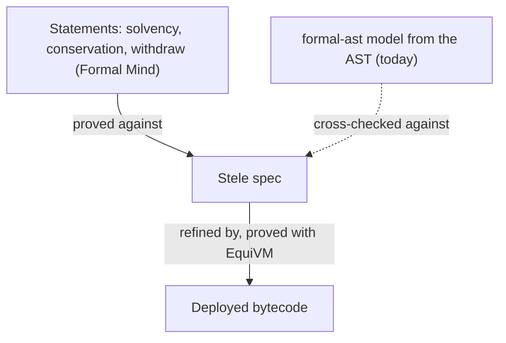
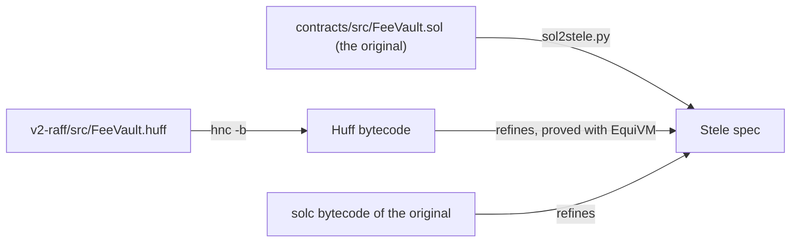

# Bytecode refinement with EquiVM

Formal Mind proves what a contract does against a Lean model that formal-ast builds from solc's AST. That leaves the
compiler trusted: our WETH9 audit says so in its scope. EquiVM ([argotorg/EquiVM](https://github.com/argotorg/EquiVM),
MIT; the paper is "Foundational Refinement Proofs for EVM Bytecode, at the Price of Tokens", Lazaropoulos and
Paraskevopoulou, arXiv 2607.26306) closes that gap: it proves that deployed bytecode refines a spec written in Stele,
a Solidity-like language with a formal semantics, on an executable EVM model that passes the Ethereum conformance
tests. Agents write the proofs; the paper reports 35 production contracts, among them WETH9, Morpho Blue, Safe,
Comet and Uniswap v3 and v4.

We build on EquiVM, not beside it: it is the bytecode layer, and Formal Mind stays the loop around it (the plan, the
statements, the swarm, the ledger, the review, the MCP, publishing).



## Steps

1. **Run EquiVM in the app.** A folder gets a `[bytecode]` section in `formalmind.toml` naming an EquiVM checkout
   (pinned commit) and the contract's artifacts (`creation.hex`, `runtime.hex`, ABI, solc version and flags). The app
   compiles the contract the way it is deployed and runs EquiVM's scaffold (`scripts/scaffold.py`,
   `scripts/sol2stele.py`, `scripts/proof_skeleton.py`). Upstream EquiVM pins Lean v4.29, so the app needs our v4.35
   port to share the swarm's toolchain ([the trial](#trial-feevault-on-lean-435-2026-11-03)).
2. **Refinement as plan items.** One item per function: prove the bytecode of that function's dispatcher arm refines
   its Stele transition, with EquiVM's prompt (`Misc/prompt.md`) as the prover's skill on top of ours. The swarm
   keeps its loop (prove, `lake build`, review); the reviewer checks the Stele spec against the Solidity. The ledger
   records `contractRefinement` per contract and each function's theorem.
3. **Test the spec against the bytecode before proving.** EquiVM's differential tests run the spec and the bytecode on
   random calls; we add our own runner (anvil, the Bug Hunter) and file each disagreement as a finding. In the paper
   this is where most spec mistakes, the checks solc inserts, and a known compiler bug surfaced.
4. **Statements on the Stele spec.** Formal Mind's statements (invariants, conservation, sequences) are proved against
   the Stele spec, so with refinement they hold for the bytecode. EquiVM's `Proofs/` already shows the ERC20 invariant
   that total supply equals the sum of balances this way.
5. **Repair across commits.** When the source or the compiler settings change, the swarm repairs the refinement proof
   from the previous one (the paper: under two hours per Safe commit against eighteen for the first proof).

## First targets

- **WETH9.** EquiVM's `Benchmarks/WETH9` proves the canonical source (solc 0.5.16, optimizer 200 runs). Link our seven
  WETH9 statements to it: prove them against its Stele spec.
- **Morpho Blue.** Also an EquiVM benchmark (byte-identical to mainnet); our Morpho Blue swarm proved 2 of 37 against
  the AST model.

## Spike: EquiVM's WETH9 on this machine (2026-10-27)

- `lake build Benchmarks.WETH9.Correct` at EquiVM `main` builds in about five minutes (3,515 jobs, Lean v4.29.0,
  Mathlib from the cache).
- The capstone is `Benchmarks.WETH9.weth9ContractCorrect : contractRefinementWF weth9StorageWF noGasBound config
  weth9CreationBytecode contract`. Its side condition `weth9StorageWF` bounds the length of the stored `name` and
  `symbol` strings when they are returned; `noGasBound` means no gas bound is assumed.
- It rests on Lean's three standard axioms and on 2,611 `native_decide` axioms: concrete facts (decoding, storage
  slots) checked by Lean's compiled evaluator, which EquiVM documents as part of its trusted base. Formal Mind's own
  rule refuses `native_decide`, so the ledger can't count these proofs as they are. Either the bytecode layer accepts
  `native_decide` as a stated part of its trusted base, or those facts are re-proved with `decide` (slower to check).

## Decision: `native_decide` in the bytecode layer (2026-10-27)

The bytecode layer accepts `native_decide`, and says so. Proofs that carry a property to the bytecode through EquiVM
may rest on `native_decide` facts; every audit that cites them lists "Lean's compiled evaluator, for the concrete
facts in the bytecode proofs" in its trusted base, with the count. Proofs about the source model and about Stele specs
keep the strict rule: no `native_decide`.

## Decision: EquiVM is the semantics of record (2026-11-03)

Formal Mind doesn't build a new mathematical model, and the SolidCore plan in
[solidity-semantics.md](solidity-semantics.md) is dropped. EquiVM supplies the EVM model, the Stele spec language, the
refinement relation and the proof scaffolding; Formal Mind stays the loop around them.

## Trial: FeeVault on Lean 4.35 (2026-11-03)

The trial asked two things: can EquiVM move to the swarm's Lean version, and what does a real contract cost? Both ran
on local branches of EquiVM and its EVMLean dependency (not pushed), from EquiVM `fc74a646` and EVMLean `fd4f5e6d6d`.

**The port to v4.35.** These targets build:

- `Ethereum` (EVMLean), `ABI`, `Stele` and `Reasoning`.
- `Examples.ERC20.Correct` and `Examples.TinyImmutable.Correct`.
- `Benchmarks.WETH9.Correct`.

Most fixes were proof-script repairs, mainly `simpa` calls whose closing check got stricter. The one change to a
definition is the rename of Batteries' `RBMap` and `RBSet` to their new `RBTree` namespace, which also touches names in
the EVM semantics. Stele's semantics is unchanged. The package sets two compatibility options:
`backward.isDefEq.respectTransparency = false` and `backward.defeqAttrib.useBackward = true`. The ERC20 and
TinyImmutable theorems have the same axioms on both versions. WETH9's have the same counts, with 20 `native_decide`
names differing only in their numeric suffix; the propositions behind those 20 weren't compared. The port cost about
407k tokens and 3h16 on a shared machine.

**The theorem.** Every function and the constructor of `src/FeeVault.sol`, about 50 lines of Solidity, built the way it
was deployed (solc 0.8.26, 1,000 optimizer runs, cancun):

```lean
def feeVaultGasBound : GasBound := fun g => g.toNat < 2 ^ 44

theorem feeVaultContractCorrect :
    contractRefinementWF trivialStorageWF feeVaultGasBound config feeVaultCreationBytecode contract
```

A clean rebuild of the contract's directory takes 197 seconds, and the directory has no `sorry`, `admit` or `axiom`.
`#print axioms` from a separate v4.35 project shows Lean's three standard axioms and 2,155 `native_decide` facts. The
gas bound comes from the memory library, which needs offsets below 2^32; no real transaction reaches it.

| Cost | |
| --- | --- |
| Hand-written proof lines | 4,647 (2,743, then 1,904 for `unlockCallback`) |
| Tokens | About 1.64M across two stages |
| `unlockCallback` and the capstone | 33 minutes |
| Moving the v4.29 proofs to v4.35 | About 4 minutes, 35 changed lines |

This is one small contract, so don't scale these numbers to larger contracts until a second one is measured.

**Differential tests.** 425 generated calls and 10 hand-built `unlockCallback` calls, no disagreements. Generated
`data` never makes `unlockCallback` succeed, so its only successful cases are 4 of the hand-built ones.

**What the theorem doesn't say.**

- Revert reasons are not compared, and neither are logs on success, so `FeesCollected` isn't verified. This comes from
  `execResultsEquiv` in `Stele/Refine.lean`.
- External calls are opaque: nothing is said about what the pool manager or the hook actually do.
- Refinement isn't a safety property. Statements such as "only the owner can collect" still have to be proved on the
  spec.

**Before the port can be relied on, in order:**

1. Run EVMLean's conformance tests on v4.35. They haven't run, so the EVM model has no fresh evidence on this version.
2. Port the remaining `Examples` so `stele-difftest` builds. `finish_check.py` passes only with `--skip-difftest` until
   then; the differential results above came through `lake env lean`. Most of `Benchmarks`, `Tests` and `Proofs` are
   also unported.
3. Check that new proofs importing EquiVM work with the compatibility options, and read the full `RBTree` rename diff.
   Batteries plans to replace `RBTree` with `Std.TreeMap`, so that code will have to move again.
4. Decide where the port lives: a fork under formalmind, or upstream. The bump hasn't been tested on v4.29 and hasn't
   been raised with the authors.

## Huff contracts: v2-raff (planned 2026-10-28)

asyncswap/v2-raff ports asyncswap/contracts to Huff, compiled with Huff Neo (`hnc`). Huff has no AST that formal-ast
can read, and today the swarm stops on it ("formal-ast found no function in scope"). EquiVM never reads source,
only bytecode, so a Huff contract fits the same pipeline. Its spec comes from the Solidity it was ported from:



When both bytecodes refine the same spec, the Huff port does what the original does, and every statement proved
on that spec holds for both. This is the equivalence v2-raff needs, and it uses no Huff-specific prover.

1. **The folder knows it's Huff.** `formalmind.toml` gets `[bytecode] compiler = "hnc"` and `original =` the path of
   the Solidity repository. The plan takes its functions from the original's ABI, matched to the Huff dispatcher by
   selector, instead of from formal-ast. Until this lands, the swarm says "a Huff project: add a `[bytecode]`
   section" instead of "no script under script/".
2. **Differential tests first.** Run the Huff and the solc bytecode on the same random calls and states (EquiVM's
   tests, our anvil runner, the Bug Hunter) and compare return data, storage, logs and reverts. Each disagreement is
   a finding with a Foundry PoC. The original's Foundry suite already runs against v2-raff, so this extends what
   exists.
3. **Refinement per function, smallest first.** FeeVault (the hook's vault, deployed from `src/generated/`), then the
   claims contracts, then Router and AsyncSwap. Hand-written Huff skips solc's checks and reuses stack slots, so
   proofs may take longer than for solc output. FeeVault shows how much longer before the larger contracts start: the
   solc build is the baseline ([the trial](#trial-feevault-on-lean-435-2026-11-03)), and the Huff build isn't proved.
4. **Statements carry over.** Statements proved on the Stele spec hold for the Huff bytecode as soon as its
   refinement is proved.

**Why EquiVM and not EVMYulLean directly.** paradigmxyz/EVMYulLean (Apache-2.0) is an EVM model too, and solidus
builds a verified Yul → bytecode compiler on it. Using it means building our own refinement framework, spec
language and proof scaffolding, which EquiVM already has, MIT, with 35 contracts proved. EVMYulLean, solidus and
solidity-lean stay references. solidus and solidity-lean depend on danrobinson/evm-interaction, which has no
licence, so neither can be vendored as it is. NethermindEth/Clear is non-commercial only and is not used.

## Open questions

- Keep the formal-ast model as the fast first pass, and refinement as the stronger layer? Or move statements to Stele
  outright?
- Talk to the authors (the paper's contact is the corresponding author, Zoe Paraskevopoulou) about upstreaming our
  statements and the swarm loop as an EquiVM front end.
