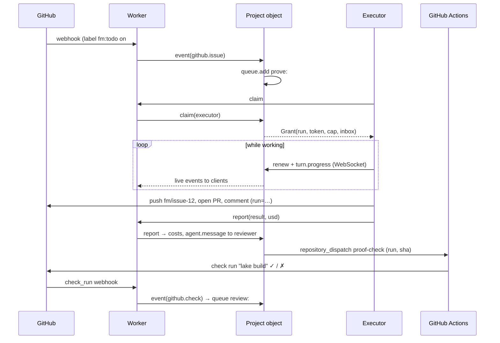

# Formal Mind protocol, v1

Status: draft. Builds on `protocol-v1-draft.md` (architecture, lifecycle and turn state machines) and turns it
into the messages, records and rules each part must follow. Scope is Solidity; nothing here is Solidity-specific
except the rebuilder's toolchain.

The words MUST, SHOULD and MAY are used as in RFC 2119.

## 1. Parts

| Part | Runs on | Holds state? | Job |
| --- | --- | --- | --- |
| **Worker** | Cloudflare Worker (formal.team) | no | Sign-in, API, GitHub webhooks, token exchange. Routes every request to a Durable Object. |
| **Project object** | one Durable Object per project | yes (SQLite) | The project's event log, queue, lease, budget and spend. Decides who works next. Pushes live events to clients. |
| **User object** | one Durable Object per user | yes (SQLite) | Account, credits, preferences, private chats, the projects the user can see. |
| **Directory** | D1 | yes, small | Indexes only: GitHub login → user, repository → project. Nothing that changes per turn. |
| **Executor** | Container, the user's machine, or GitHub Actions | no | Does one turn at a time: checkout, agent run, push. |
| **Record** | GitHub | yes | Branches, PRs, `fm:` labels, notebook issues, `.formal/notebook.json` and `.formal/plan.md`. The source of truth. |

Distribution comes from the project object: every project is its own single-threaded actor, placed near the
people using it, with no shared lock between projects. A project never waits on another one.

## 2. Names

- **Project id**: the repository that holds the proofs, lower-cased: `owner/name`. Its object is
  `PROJECT.idFromName("project:" + id)`.
- **User id**: `github:<numeric GitHub user id>`. Its object is `USER.idFromName(userId)`. Logins change; ids do not.
- **Run id**: a ULID minted by the project object when it grants a turn. Every effect of that turn carries it.
- **Event id**: `<project id>#<sequence>`; the sequence is the project log's row number, gap-free, starting at 1.

## 3. The record on GitHub

GitHub stays the place anyone can audit, and the place a lost object is rebuilt from (section 11).

### 3.1 notebook.json

`.formal/notebook.json` on the integration branch (`formalmind`). The same `.formal/` folder holds
`plan.md`, the decisions and roadmap, and works the same in a local folder. Readers fall back to
`.github/formalmind/notebook.json` and the README's Roadmap for projects not yet moved.

```json
{
  "version": 1,
  "mode": "hosted",
  "protocol": { "repo": "asyncswap/v2", "language": "solidity" },
  "upstream": null,
  "maintainers": ["mmsaki"],
  "branch": "formalmind",
  "issues": { "ledger": 1, "notebook": 2, "chief": 3, "assistant": 4 },
  "budget": { "dailyUsd": 5, "monthlyUsd": 150 },
  "executor": "hosted"
}
```

`mode` is `hosted | shadow`. Shadow adds `"upstream": { "repo", "sha", "paths" }` or `"paste": true`.
`executor` is `hosted | local | ci`. The project object MUST treat this file as configuration and re-read it
on every push to `formalmind`.

### 3.2 Markers

Every comment the swarm writes starts with one HTML comment, so state can be rebuilt by parsing GitHub alone.
Fields are `key=value`, space-separated, values without spaces.

| Marker | Where | Meaning |
| --- | --- | --- |
| `<!-- fm-cost role= ref= usd= run= repo= -->` | ledger issue | One turn's spend. `usd` has two decimals. |
| `<!-- fm-note role= ref= run= phase= -->` | notebook issue | A turn's task list; edited in place as it runs. |
| `<!-- fm-next to= ref= run= -->` | the issue or PR worked on | The hand-off: who acts next. |
| `<!-- fm-cycle n= phase= -->` | notebook issue | The rebuild cycle's position. |
| `<!-- fm-ask role= from= run= -->` | any issue or PR | A question to a role (also written as `/ask <role> …`). |
| `<!-- fm-msg id= run= from= to= kind= -->` | the issue or PR it is about | One agent message (section 6.2). |

Markers MUST NOT be edited after the turn that wrote them reports, except `fm-note` while its own turn runs.

## 4. Project object

### 4.1 Storage

SQLite tables inside the object (names are part of the protocol so tools can read a backup):

```sql
events  (seq INTEGER PRIMARY KEY, at TEXT, type TEXT, actor TEXT, run TEXT, body TEXT)  -- append-only
queue   (job TEXT PRIMARY KEY, kind TEXT, ref TEXT, priority INTEGER, enqueued_at TEXT, not_before TEXT)
lease   (run TEXT PRIMARY KEY, job TEXT, executor TEXT, granted_at TEXT, expires_at TEXT, cap_usd REAL)
costs   (key TEXT PRIMARY KEY, repo TEXT, role TEXT, ref TEXT, usd REAL, run_id TEXT, created_at TEXT)
meta    (key TEXT PRIMARY KEY, value TEXT)                                       -- config, sync cursors
```

All other state (budget left today, who has the turn, what is blocked) MUST be derived from `events`, `lease`
and `costs`, never stored twice.

### 4.2 Events

Each change to a project is one appended event. Clients and executors see the same stream.

| type | from | body |
| --- | --- | --- |
| `github.push` | webhook | `{ branch, before, after }` |
| `github.issue` / `github.pr` | webhook | `{ number, action, labels }` |
| `github.comment` | webhook | `{ number, url, author, marker? }` |
| `client.ask` | a user | `{ role, text, ref? }` |
| `client.budget` | a maintainer | `{ dailyUsd?, monthlyUsd? }` |
| `queue.add` / `queue.drop` | the object | `{ job, kind, ref, priority }` |
| `lease.grant` | the object | `{ run, job, executor, capUsd, expiresAt }` |
| `lease.renew` | executor | `{ run, expiresAt }` |
| `lease.expire` | the object | `{ run, job }` (job goes back on the queue) |
| `turn.progress` | executor | `{ run, step, text }` |
| `turn.result` | executor | `{ run, outcome, usd, next: { to, ref } }` |
| `budget.pause` / `budget.resume` | the object | `{ reason }` |

`outcome` is `done | asked | blocked | capped | failed`.

### 4.3 Queue and priority

Jobs come from labels and comments: an `fm:` label change, a `/ask`, a `fm-next` hand-off, a sync with `main`.
Priority, highest first: **answer** a question › **merge** › **review** › **revise** › **resume** › **new issue**
› **plan**. Ties go to the oldest. A job id is `<kind>:<ref>`, so the same work is never queued twice.

### 4.4 Lease

1. On any event, if there is no live lease, the queue is not empty and the budget allows it, the object grants
   the top job: it mints a run id, sets `expires_at = now + 5 min`, and appends `lease.grant`.
2. The executor MUST renew (`lease.renew`) at least every 60 s while it works. Each renewal moves `expires_at`
   to `now + 5 min`.
3. When the alarm fires past `expires_at` with no result, the object appends `lease.expire` and requeues the job.
   A late result from that run is ignored except for its cost, which is always recorded.
4. There is at most one live lease per project. Granting is the only way to start work.

### 4.5 Budget

- `spentToday` is the sum of `costs.usd` with `created_at` in the current UTC day; `spentMonth` likewise.
- A lease's cap is `min(per-turn cap, dailyUsd − spentToday, monthlyUsd − spentMonth)`. Under $0.10, the object
  does not grant and appends `budget.pause`. At 00:00 UTC an alarm appends `budget.resume`.
- A turn that ends without reporting a cost is charged its whole cap, so the budget stays honest.
- Hosted model spend is also debited from the paying user's credits (section 7) when the cost is recorded.

### 4.6 Interfaces

The Worker calls the object over RPC; nothing else can reach it.

```ts
interface Project {
  event(e: { type: string; actor: string; body: unknown }): Promise<{ seq: number }>;
  state(): Promise<ProjectState>;                 // folded view for the board
  costs(): Promise<{ costs: Cost[]; syncedAt: number | null }>;
  claim(executor: string): Promise<Grant | null>; // an executor asks for work
  renew(run: string): Promise<{ expiresAt: string } | { lost: true }>;
  report(run: string, result: TurnResult): Promise<void>;
  connect(request: Request): Promise<Response>;   // WebSocket upgrade for live clients
}
```

### 4.7 Live clients

Browsers open `wss://formal.team/api/projects/<owner>/<name>/live`. The Worker checks the session and that the
user can see the project, then hands the socket to the object (hibernatable WebSockets). The object sends
`{ seq, type, body }` for every new event; a client that reconnects sends its last `seq` and gets the gap.
This replaces polling GitHub from the browser.

## 5. Executors

### 5.1 Turn

A turn is `(job, repo@sha, token, capUsd)`. The executor:

1. calls `POST /api/executors/claim` with its executor credential and gets a `Grant`, or 204 when there is no work;
2. checks out `fm/<kind>-<ref>` from the given sha and opens its `fm-note`;
3. runs the agent, sending `turn.progress` and renewing the lease;
4. pushes, moves labels, writes the `fm-next` and `fm-cost` markers, all carrying `run=<id>`;
5. calls `POST /api/executors/report` with the result.

```ts
type Grant = {
  run: string; project: string; job: { kind: string; ref: string };
  repo: string; sha: string; branch: string;
  token: string;            // formalmind[bot] installation token, scoped to this repo, ~1 h
  capUsd: number; expiresAt: string;
  prompt: { role: string; instructions: string };
};
```

### 5.2 Kinds

| Executor | Claims with | Notes |
| --- | --- | --- |
| hosted | a Worker-issued key per container | Lean, Mathlib cache and Foundry warm. Our model key, billed to the project. |
| local | the user's session, from the macOS app | Code never leaves the machine. The user's own model key. |
| ci | GitHub Actions OIDC token | Only the `lake build` / no-`sorry` gate on PRs. Not the swarm. |

### 5.3 Idempotence

Before any write, an executor MUST check whether an effect with its `run` already exists (a comment with that
marker, a commit trailer `Formal-Mind-Run: <id>`, a label already set) and skip it. A retried or duplicated turn
therefore changes nothing twice.

## 6. Communication

Agents never call each other directly, and no process holds a connection to another project. Everything moves
as messages through the project object, which orders them in its event log. That keeps one writer per project
and makes every conversation replayable.

### 6.1 Channels

| From → to | Channel | Use |
| --- | --- | --- |
| Agent → agent (same project) | `agent.message` event in the project object, mirrored as a GitHub comment | Hand-offs, questions, review verdicts |
| Agent → human | `fm-next to=@login` / `fm-ask` comment, plus a notification to the user object | Decisions only a maintainer can make |
| Human → agent | `client.ask` event (web, app) or `/ask <role>` comment (GitHub) | Questions and instructions |
| Executor → project object | `claim` / `renew` / `report` over HTTPS, `turn.progress` over a WebSocket | The turn itself |
| GitHub → project object | App webhook → Worker → `event()` | Pushes, labels, comments, check results |
| Project object → CI | `repository_dispatch` or `workflow_dispatch` with the run id | Proof checks and other CI-only work (6.4) |
| CI → project object | GitHub check run / `workflow_run` webhook; or OIDC `report` | The gate's verdict |
| Project object → clients | Hibernatable WebSocket | Live board, chats, notifications |
| Project → project | none | Forbidden (invariant 7); cross-project views read each object separately |

### 6.2 Agent messages

```ts
type AgentMessage = {
  id: string;              // event id
  run: string;             // the turn that wrote it
  from: Role | `@${string}`;
  to: Role | `@${string}` | "nobody";
  kind: "handoff" | "ask" | "answer" | "verdict" | "note";
  ref: string;             // issue or PR number in the project
  text: string;            // markdown; what the GitHub comment shows
  verdict?: "approve" | "changes" | "blocked";
  replyTo?: string;        // the message this answers
};
```

Roles: `planner`, `prover`, `reviewer`, `merger`, `rebuilder`, `editor`, `chief`, `assistant`.

Rules:

1. A message is written by appending its event first, then posting the GitHub comment with
   `<!-- fm-msg id= run= from= to= kind= -->`. The webhook echo of that comment is recognised by `id` and
   dropped, so the log has each message once.
2. A message `to` a role enqueues a job for that role on `ref` (priority from 4.3: `ask` → answer, `verdict:
   changes` → revise, `verdict: approve` → merge, `handoff` → the role's normal job).
3. A message `to` a human sets the item to waiting (`fm:ask-human`) and notifies that user's object. The project
   grants no turn on that item until a human message or `fm:human-ok` arrives.
4. An agent sees, in its `Grant.prompt`, every message on its `ref` since the last turn of its own role, oldest
   first. That is its inbox; there is no other memory between turns.
5. At most one open `ask` per `(ref, to)`. A second one is merged into the first.

### 6.3 One turn, end to end



### 6.4 When to use CI

The project object decides where each piece of work runs. CI is used when the work must be **trusted by the
repository owner, reproducible from the repo alone, or visible as a GitHub check**; everything else runs on an
executor, where it is faster and streams live.

| Work | Runs on | Why |
| --- | --- | --- |
| `lake build` + no `sorry` / new axiom gate on a PR | CI | The repo's own check; maintainers trust it and branch protection can require it |
| Rebuilding Solidity specs after `main` moves (`forge build`, extraction) | CI, then an executor | Reproducible from the commit; the result feeds the rebuilder's turn |
| Shadow mode upstream snapshot | CI (scheduled) | Pulls someone else's repo without giving executors access |
| Agent turns (plan, prove, review, merge, …) | Executor | Needs the model, warm Mathlib and live progress |
| Budget, queue, leases, hand-offs | Project object | Must be ordered and instant |
| Webhook intake, sign-in, token exchange | Worker | Stateless and at the edge |

CI talks to the project object only through GitHub (check runs and `workflow_run` webhooks) or by `report` with
its OIDC token; it never receives the App key. A dispatched workflow MUST carry the `run` id in its inputs and
in the check run's `external_id`, so its result lands on the right turn.

### 6.5 Delivery guarantees

- Webhooks: at least once; deduplicated on `X-GitHub-Delivery` (section 8).
- Executor calls: retried with the same `run`; `report` is idempotent per run.
- Client WebSockets: at least once, in `seq` order; clients drop events they have seen.
- CI dispatch: at least once; a check run for an already-decided `run` is recorded and ignored.

## 7. User object and accounts

- Created on first sign-in through the GitHub App's user authorization (no Auth0). Stores profile, created and
  last-seen times, credits (prepaid cents and a ledger of deposits and debits), plan, and private chats.
- The Directory maps `login → userId` and `userId → [project ids]`. It is the only table queried across users.
- Plans come from GitHub Marketplace (`marketplace_purchase` webhooks) or Stripe deposits; both append to the
  user's credit ledger.
- Users from before v1 are not migrated: v1 starts with an empty Directory.

## 8. Worker routes

| Route | Auth | Goes to |
| --- | --- | --- |
| `GET /auth/*`, `GET /login/callback` | none | sign-in, creates or updates the user object |
| `POST /api/github/webhook` | App webhook signature | the project object for `repository.full_name` |
| `POST /api/github/marketplace` | marketplace signature | the purchaser's user object |
| `GET /api/projects/:owner/:name/state` | session | project `state()` |
| `GET /api/projects/:owner/:name/live` | session | project `connect()` |
| `GET /api/usage` | session | the user's projects' `costs()` |
| `POST /api/executors/claim` · `report` · `renew` | executor credential | the project object |

Webhook deliveries MUST be deduplicated on `X-GitHub-Delivery` (kept 24 h in the project object's `meta`).

## 9. Identity and secrets

- Only the Worker holds the App private key. Executors get a short-lived installation token, scoped to one
  repository, inside their `Grant`.
- Users set no secrets for hosted mode beyond installing the App. Local mode uses the user's own model key,
  which stays on their machine.
- Executor credentials are per executor and revocable from the project object.

## 10. Invariants

1. **One lease per project.** At most one live lease; an expired lease requeues its job.
2. **Idempotent effects.** Every comment, label and push carries `run=<id>`; retries do nothing twice.
3. **Append-only logs.** The event log, ledger and notebook only grow; all state is a fold over them.
4. **GitHub is the source of truth.** A project object can always be rebuilt from the record.
5. **Humans promote.** No executor writes to `main` or to a repository it was not granted.
6. **Honest budget.** A turn that reports no cost is charged its whole cap.
7. **No cross-project waiting.** No operation on one project may wait on another project's object.

## 11. Rebuilding a project object

If an object's storage is lost or a project is adopted, the object rebuilds by reading, in order:
`notebook.json`, the ledger (`fm-cost`), the notebook (`fm-note`, `fm-cycle`), open issues and PRs with `fm:`
labels, and the latest `fm-next` on each. It appends one `rebuild` event with the cursor it reached, then
resumes from webhooks. Rebuilding MUST be safe to run twice.

## 12. Migration from today's app

| Step | Ships | Retires |
| --- | --- | --- |
| 1. New App and accounts | The formalmind organisation's App; user objects and the Directory; fresh D1 | The personal App, `formalmind-users`, Auth0 leftovers |
| 2. Project objects | One object per project, fed by webhooks; board, Usage and swarm state read from it; live WebSocket | Polling GitHub from the browser; the shared-ledger spend object |
| 3. Dispatcher | Leases granted by the project object; GitHub Actions as the first executor via claim/report | The 10-minute cron sweep |
| 4. Hosted executors | Containers with Lean and Mathlib warm | Running the swarm on Actions |
| 5. Local executor | The macOS app claims turns for its user's projects | — |

Each step keeps the record format of section 3, so projects keep working across the switch.

## 13. Open questions

- Hosted executor: Cloudflare Containers or a runner pool (Mathlib cache size, cold start, cost).
- Who pays hosted model spend for grant-funded public projects.
- Moving `asyncswap/v2-proofs` into `asyncswap/v2` (`proofs/` on the `formalmind` branch).
- Whether chats belong to the user object (private) or the project object (shared with maintainers).
