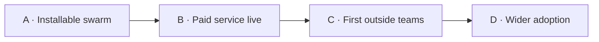

# Roadmap

What Formal Mind is, the problem it solves and its focus: [README.md](../README.md).

## Standing rules

- **Keep the UI.** The website, the Mac app and the mobile app keep their screens: the four tabs (Bugs, Swarm, Proofs,
  Code), the folder page, the chat and the canvas. Polish is fine; redesigns are not on the roadmap.
- **The agents work the same.** The swarm stays brute force: the plan has one item per in-scope function, a prover
  writes a refinement theorem for each, `lake build` checks it, the reviewer checks it against the Solidity, and bugs
  need a Foundry PoC (`desktop/SWARM-STATES.md`, `worker/skills.ts`). Don't replace this loop with a cleverer one;
  scale it to more repositories.
- **The skills stay the same.** The four published skills (`run-the-local-swarm`, `onboard-a-repository`,
  `read-formal-mind-results`, `connect-formal-mind-as-mcp` in `worker/skills.ts`), the Lean proving skills in
  `formalmind/skills`, and the planner, prover, reviewer and answer prompts keep their behaviour. Fix facts that go
  stale; don't change what they tell an agent to do.

## Where we are (2026-10-25)

- **The brute-force line is desktop 0.1.41** (`9c60c01`). formal-ast turns solc's AST into a shallow Lean model, one
  function at a time, and the swarm proves each one. On Async Swap it reached AsyncSwap 128/143 functions proved
  (89.5%) and Router 35/46 (76.1%): 1,336 theorems, no `sorry`.
- **Those proofs were retired** from asyncswap/contracts in `f243b0b` (2026-10-23) when the contracts changed. They are
  intact at `e04668e`, checked out as `~/developer/asyncswap/contracts-lean` (branch
  `formal/lean-archive-2026-10-22`, local only). Add that folder in 0.1.41 to see them.
- **Why they broke:** proofs unfold the generated text (names with solc node ids, the order of `if`s, the shape of
  `Ext`), so a code change breaks them even when the property still holds (`docs/solidity-semantics.md` §1 on
  PR formalmind/formalmind#15).
- **Since 0.1.41** the UI improved (keep it), and the Concolic hunter was built on `release/0.2` as a separate line.

## Method

1. **Specs chase `main`.** Each commit on the target's default branch gets its spec rebuilt, and the swarm repairs what
   broke. Work already done is cached: a proof is re-checked, not rewritten, when its function didn't change.
2. **Model the whole language: SolidCore.** Paradigm's executable Lean semantics of Solidity
   ([paradigmxyz/solidity-lean](https://github.com/paradigmxyz/solidity-lean)) becomes the semantics of record.
   formal-ast emits its AST. Today's shallow model stays, linked to SolidCore per function, so the existing theorems
   keep counting. The two-week spike on `AsyncSwap.setExecutor` decides whether we prove against SolidCore directly or
   against our own small typed core checked against it.
3. **Tactics that survive edits.** `Std.WP` + `vcgen` with `@[spec]` lemmas per Solidity primitive and per function
   signature. Specs state what the function does to the protocol model, never its body. These spec lemmas become the
   shared lemma library.
4. **Agents keep the brute-force loop** (one item per function, prove, `lake build`, review) on top of the new
   semantics.
5. **Concolic stays a separate product line, offered to agents as a skill.** The hunter's dogfooding (concolity
   `HUNTING.md`) found the tools pay off as fast, narrow questions (`coverage --at`, `explore --target`, z3 on a
   guard) and as PoC runners, not as whole reports. For the formal agents that means: try to falsify a theorem
   statement before spending a prover on it, and back every bug with a run.
6. **Review comments on every diff and pull request**, like the old GitHub App: one comment per PR naming the
   theorems the diff breaks, the functions that lose coverage, and any leads. Opt-in per repository; the local swarm
   still writes nothing to GitHub by default.
7. **Bring your own skills and agents.** Auditors already run their own agents (Nethermind's AuditAgent, Pashov's
   skills, 33Labs). Formal Mind supplies the loop around them: the AST slices, the plan, the checks (`lake build`,
   `forge test`), the review step and one merged report. Their skills plug in; ours stay as they are. Plan: [skills.md](skills.md):
   a Skills page of free third-party skills added to a folder's swarm, and a prior-findings search over the public
   audit corpus as an agent tool.
8. **Verify the bytecode, not only the source: EquiVM.** Build on [argotorg/EquiVM](https://github.com/argotorg/EquiVM)
   (MIT): agents prove the deployed bytecode refines a Stele spec, so the compiler leaves the trusted base, and our
   statements are proved on the Stele spec. WETH9 and Morpho Blue are already EquiVM benchmarks. Huff contracts
   (asyncswap/v2-raff, built with `hnc`) go through the same layer: their bytecode is proved to refine the Stele spec
   of the Solidity they were ported from. Plan: [bytecode-refinement.md](bytecode-refinement.md).
9. **A branch viewer.** Every branch of the repository's history in one diagram, each commit marked with what was
   verified at it (spec built, functions proved), and the branch the specs chase highlighted.

## Decisions to make

| # | Question | Recommendation |
| --- | --- | --- |
| 1 | Run the SolidCore spike now, or keep the shallow model and let agents repair proofs after each change? | Run the spike first. It's two weeks, and it decides whether proofs can survive edits at all. |
| 2 | Where do Async Swap's proofs live again? | In a proofs repository beside asyncswap/contracts that follows its commits, so contracts stay free to change. |
| 3 | Concolic skill for the formal agents in 0.1.x, or only in 0.2? | Add it as an extra skill once 0.2 ships; the four published skills don't change. |
| 4 | Bring back PR review comments? | Yes, opt-in. It's what outside teams see first. |
| 5 | EquiVM's Stele spec as the semantics of record, beside or instead of SolidCore? | Start beside: link WETH9's statements to EquiVM's WETH9 benchmark first, then decide with SolidCore's spike. |
| 6 | Prove Huff (v2-raff) with EquiVM, or build our own EVM layer on EVMYulLean? | EquiVM: it proves any bytecode refines a spec, so the Huff port is proved against its Solidity original's spec. Spike on FeeVault first. |

## Milestones

### A. Installable swarm

- One setup command produces a building Lean project and a passing CI gate on any Solidity repository, shown on 2
  public repositories Async Swap Labs doesn't own.
- A shared library of at least 20 proven lemmas for common contract patterns (ERC-20 accounting, escrow, fee splits),
  published under MIT.

### B. Paid service live

- A team connects a repository, sets a daily budget and sees proof status.
- A public API endpoint, documented, accepts verification jobs from developers and their own agents.

### C. First outside teams

- At least 3 teams outside Async Swap Labs run the swarm on their own Ethereum or L2 contracts, each with at least 1
  proof merged; at least 1 of them a protocol holding over $100 million onchain or an audit firm from the list below.
- Those teams pay for their swarm budgets.

### D. Wider adoption

- At least 5 more outside teams, each with at least 1 proof merged; at least 3 of them a protocol holding over
  $100 million onchain or an audit firm from the list below.
- Paid swarm budgets grow with them.

Audit firms we aim for: OpenZeppelin, Trail of Bits, Certora, Runtime Verification, Spearbit, Cyfrin, Nethermind
Security, ChainSecurity, Sherlock, Code4rena, Cantina, Immunefi.

## Commitments

- Swarm templates, role prompts and the shared lemma library under MIT. The hosted service stays closed source.
- Out of scope: chains other than Ethereum and its L2s, guaranteeing a verified contract is bug-free (each report lists
  the properties proved and their assumptions), and replacing audits. Formal Mind gives auditors and developers
  machine-checked invariants to start from.
