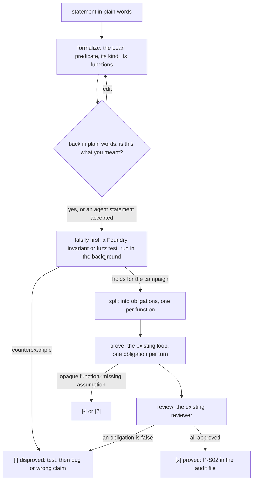

# Statements: claims in plain words, proved or disproved

**What it is.** Once the swarm has worked through the plan, the user and the agents write **statements**: claims about
the code in plain words. The swarm then proves or disproves each one:

> `Vault.totalSupply` always equals the sum of `balanceOf` over every account.
>
> Only the owner can change `fee`.
>
> `withdraw` never pays out more than `shares × pricePerShare`, rounded down.

Each statement ends in one of three ways:

- **proved**, with Lean theorems the reviewer approved;
- **disproved**, with a counterexample: a Foundry test that shows it failing;
- **stuck**, with the reason (a function the model leaves opaque, an assumption the user has to decide).

Statements live in a checklist next to the plan, local to the folder, like everything else in `.formal/`.

This is the end of the flow: a frozen repository → the swarm proves the plan → statements → answers.

## 1. What has to stay the same

- **The one-item-per-function loop.** A statement is broken into **obligations**, one per function. Each obligation
  goes through the same prove → `check_proof` → review turn that a plan item goes through today. A statement that
  spans five functions becomes five ordinary items.
- **The role prompts and skills** (`worker/skills.ts`, the prompts in `desktop/src-tauri/src/swarm.rs`) don't change.
  What is specific to statements goes into the *task* each agent gets, the way `Context::brief` adds the target def
  and slice today, and into new tools' descriptions.
- **The UI** keeps its look. The Statements list is a list in the swarm panel, styled like the plan.
- **Local first.** Nothing goes to GitHub. Pull requests stay opt-in.

## 2. The file: `.formal/statements.md`

A checklist, readable and editable by hand like `.formal/plan.md`, and parsed the same way (`read_plan`'s rules).

```markdown
# Statements

- [x] S-01 · you · Only the owner can change `fee`.
  - kind: access · functions: `Vault.setFee` · theorems: Vault.setFee_onlyOwner
- [~] S-02 · you · `Vault.totalSupply` always equals the sum of `balanceOf`.
  - kind: invariant · 3/5 · lean: `formal/Statements/S02.lean`
  - [x] `Vault.deposit` preserves it
  - [x] `Vault.withdraw` preserves it
  - [x] `Vault.transfer` preserves it
  - [ ] `Vault.transferFrom` preserves it
  - [-] `Vault.flashLoan`: not in the model (inline assembly)
- [!] S-03 · prover · `withdraw` never pays out more than the user deposited.
  - disproved: test/formal/S03Withdraw.t.sol (a donation raises pricePerShare); the intended property is S-04
- [?] S-04 · prover · `withdraw` never pays out more than `shares × pricePerShare`, rounded down.
  - proposed: accept it to start
```

| Mark | Means |
|---|---|
| `[ ]` | open: not started |
| `[~]` | working: formalized, some obligations done |
| `[x]` | proved: every obligation approved |
| `[!]` | disproved: a counterexample, with its test |
| `[?]` | waiting for the user: a proposed statement, a formalization to confirm, or an assumption to decide |
| `[-]` | can't be proved against this model (an opaque function, or out of scope), with the reason |

- **Ids** are `S-NN`, never reused.
- **The author** is `you` or the role that proposed it.
- **The first line is the user's words, never rewritten.** The indented lines belong to the app. The app writes them,
  and a user can delete them to start that statement again.
- **The obligation lines** use the plan's format (a backticked def first), so `Context::target` finds the function
  without changes.

## 3. From words to obligations



### 3a. Formalize

This is a new job, `formalize`, run by the assistant role. The task text says what to produce, so the prompt stays as
it is. The agent has the `functions` and `function` tools (formal-ast), and the generated model. It returns:

- **the kind**:

  | Kind | Example | Obligations |
  |---|---|---|
  | `function` | `withdraw` reverts when `shares > balanceOf[msg.sender]` | one, on that function |
  | `access` | only the owner changes `fee` | one per function whose footprint writes `fee` |
  | `invariant` | `totalSupply == Σ balanceOf` | one for setup (the constructor or `initialize`), and one per external function that writes a variable the predicate reads |
  | `conservation` | every call changes `totalSupply` by the sum of the changes it makes to `balanceOf` | one per function that writes either variable |
  | `sequence` | a user can always withdraw what they deposited | tested only in v1 (§6) |

- **the predicate in Lean**: `formal/Statements/S02.lean`, defining `S02.inv : Vault.State → Prop` (or a `pre`/`post`
  pair for `function` and `access`) over the generated model's state. It contains no theorems and no `sorry`, so it
  builds on its own. `lake build Statements.S02` checks that it type-checks.
- **the functions**: each with its def, taken from formal-ast's footprint (`reads`, `writes`). Functions whose
  footprint doesn't write anything the predicate reads still get an obligation, but it is a frame lemma: the
  predicate's variables are unchanged. The prover gets a hint that it is short.
- **the assumptions** it had to make, in plain words: "the token has no fee on transfer", "`oracle.price()` is
  nonzero". Every assumption becomes a hypothesis of the theorems, and the user sees it.
- **the back-translation**: the Lean predicate read back in plain words, written without looking at the user's
  sentence. Comparing the two is the user's check.

**Sums over mappings.** `Σ balanceOf` is a sum over every address, which the model can't enumerate. The formalizer
offers the `conservation` form instead: each call changes `totalSupply` by exactly the sum of the changes to the
`balanceOf` entries it writes, which is a finite set of keys the footprint names. Together with `totalSupply == 0`
and all balances 0 at setup, that implies the global sum. The proof is per function and doesn't need a ghost
variable. The user sees why it was rewritten and confirms.

### 3b. Confirm (the questionnaire)

The user sees the statement, the kind, the functions, the assumptions and the back-translation, in the Statements list and as a question in the chat. The question comes with two or three replies the formalizer drafted in the user's voice (one confirming, the others correcting the likeliest misreadings). A click puts one in the message box to edit or send, like Draft reply, and the assistant records the answer with `confirm_statement`. Answers:

- **Yes**: it goes on to falsify.
- **Edit**: their correction goes back to formalize.
- **Assumption to decide**: the statement stays `[?]` until the user answers. For example: "Should this hold when
  `oracle.price()` returns 0?"

Agent statements start as `[?]` "proposed". The user accepts them with one click, or turns on accepting them
automatically. A strengthening lemma that the prover needs for a proof it is already doing (§3d) doesn't wait.

After the first pass over the plan, the assistant opens the questionnaire itself. It asks 3 to 5 questions drawn from
the code: the invariants the planner saw, the `invariant`-kind line tags, and money flows ("Can anyone but the depositor
withdraw a deposit?"). Each answer becomes a statement.

### 3c. Falsify first

This is the roadmap's method 5: try to falsify a statement before spending a prover on it. The app writes
`test/formal/S02.t.sol`: an `invariant_S02()` over the project's own test setup for `invariant` and `conservation`, or
a fuzz test for `function` and `access`. It runs the test in the background, as `forge test --match-path`. When
`concolity fuzz` lands (`concolity/docs/FUZZ.md`), it runs the campaign, which is already the first background tool.

- **Fails**: a counterexample. The reduced sequence becomes the test, and the statement is `[!]`. Then the assistant
  decides with the user which one it is:
  - **a bug**: the property is intended, and the code breaks it. It goes through `report_bug` with that PoC;
  - **a wrong claim**: the code is right, and the statement was wrong. The assistant proposes the statement that does
    hold, as in S-03 → S-04 above.
- **Passes**: on to proving, with the campaign's numbers kept as evidence: runs, depth and coverage.

Falsifying is cheap and runs alongside other work. A statement can go to proving while its campaign is still running.
A later counterexample stops the proof jobs.

### 3d. Prove and review: the existing loop

Each obligation is a `prove` job for one function. The prover's task comes from `Context::brief`, plus:

- the statement's predicate module, to import;
- the obligation as a theorem to prove, with its exact name and type. For an invariant:
  `theorem S02.preserved_withdraw (s : Vault.State) … (h : S02.inv s) : S02.inv (Vault.withdraw s …).2` (shaped to
  the generated def's signature and monad), and `S02.init` for setup;
- the file to write: `Proofs/Functions/S02Withdraw.lean`.

`check_proof` runs unchanged: no cheats, `lake build`, and the def named. One check is added for an obligation: the theorem with its given name is in its given file, `#print axioms` shows no `sorryAx`, and its type, as `#check` prints it, names the def. A function or access obligation is stated in words, not as a Lean type, so the type isn't matched against an expected one. Instead the reviewer gets it as Lean prints it, next to the user's words and the back-translation, and approves only if it says what the obligation says. (Invariants, step 5, come with their Lean predicate, so their obligations' types can be checked exactly.)

**Strengthening.** An invariant often isn't inductive on its own: `withdraw` preserves `S02.inv` only if
`pricePerShare > 0` too. The prover can call a new tool, `strengthen`, with the extra predicate and why it's needed.
That adds sub-statement `S-02.a`, with its own obligations, and the original obligations then assume it. The new
statement is the agent's, so the user sees it, but it doesn't wait for acceptance. Without it the proof can't go on.

**A false obligation** (the prover finds a case where the function breaks the predicate) goes the same way as a failed
campaign. The prover writes the PoC, and the statement becomes `[!]`.

### 3e. Close

When every obligation is approved, the statement is `[x]`. `record_property` writes `P-S02` into
`audit/formal-mind.audit.json` with:

- the user's words as the title;
- the reviewer's statement and assumptions as the description;
- every obligation's theorem;
- the falsifying campaign's numbers as evidence.

A statement with some obligations `[-]` is reported as partial: "proved for 4 of 5 functions; `flashLoan` is not in
the model". It is never rounded up to proved.

## 4. Changes, by file

| Where | Change |
|---|---|
| `desktop/src-tauri/src/swarm.rs` | `.formal/statements.md` read and written like the plan (`read_statements`, `set_mark` on sub-lines). New job kinds `formalize` and `falsify`. A `prove` job with an obligation carries its theorem name and type. The scheduler takes plan items and obligations from one queue: obligations first while the user is waiting on a statement, otherwise in plan order |
| `desktop/src-tauri/src/swarm_ctx.rs` | `brief` gets the obligation's theorem and the predicate's module. `record_property` takes a statement id and many theorems |
| new tools | `add_statement` (any agent: a proposal, `[?]`), `formalize_result` (the formalize job's output, validated: the module builds, every function exists), `strengthen` (the prover) |
| `desktop/src-tauri/src/analysis.rs` | a `tag` of kind `invariant` offers itself as a proposed statement |
| `desktop/src/swarm-panel.tsx` | the Statements list beside the plan: an input ("State something about the code…"), rows with the mark, the words, the kind, `n/m` obligations and links to the theorems or the PoC. A row opens to show the back-translation and assumptions, with Yes and Edit |
| `lib/audit-format.ts`, `docs/audit-format.md` | Property `status` gains `falsified` (with `poc`) and `partial`. A property may carry `statement` (its `S-NN`) and `evidence` |
| `components/` (Proofs) | a statement counts as proved only when every obligation's theorem exists without `sorry` |

## 5. What the model has to support

- **The state type.** The invariant and conservation obligations need the generated model to expose one state type per
  contract, and each def's result state. If the model threads the state through a monad, the obligation is stated
  over the monad's run (`(f args).run s`), and the predicate module gives the shape once.
- **External calls.** The shallow model's `Ext` returns whatever the call returns. An invariant that depends on a
  callee's behaviour (a token's `transfer` really moving balances) is an assumption, written as one. Reentrancy: an
  invariant is proved for calls that don't reenter unless the model's `Ext` allows it. That limit goes into the
  statement's assumptions automatically, so a proved invariant never hides it.
- **SolidCore.** When the roadmap's SolidCore decision lands, the predicates move to its state type. The plain words
  and the obligations stay the same.

## 6. Not in v1

- **`sequence` statements** ("can always withdraw", "nothing gets stuck"). These are liveness and existence claims
  over reachable states. v1 formalizes them, falsifies them with a campaign, and reports them as **tested, not
  proved**, with the campaign's numbers. Proving them needs a reachability model of the protocol.
- **Statements across commits** ("the fix didn't change anything else"). That is `concolity fuzz --against`'s job for
  now. Statements are tied to the commit they were proved at, which the frozen-repository flow assumes.
- **Statements across contracts** whose models don't share state.

## 7. Order, and how each step is checked

1. **The file and the list.** `.formal/statements.md`, the panel list, `add_statement`, and the marks. *Check*: a hand
   written statement shows up, survives a restart (`queue.json` resumes it), and editing the file by hand is picked
   up.
2. **Formalize and confirm** for the `function` and `access` kinds. *Check*: on a fixture vault, "only the owner can
   change `fee`" becomes one obligation per writer of `fee` (from the footprint), and the back-translation matches.
3. **Prove through the existing loop.** Obligations as `prove` jobs, the theorem-type check, `record_property`.
   *Check*: S-01 proved end to end. The plan's own items are unaffected: the same jobs and the same order.
4. **Falsify first** with forge's invariant runner. *Check*: a deliberately false statement on the fixture
   ("withdraw never pays more than was deposited", with a donation path) comes back `[!]` with a passing PoC, and
   no prover turn is spent on it.
5. **Invariants and conservation**, with `strengthen`. *Check*: the fixture's `totalSupply == Σ balanceOf` is proved
   through its conservation form; one function left opaque in the model makes it partial, not proved.
6. **The questionnaire** after the first plan pass, and tags as proposals. *Check*: on Async Swap, the assistant's
   questions include the money invariants the hunt used (escrow equals the sum of resting orders' `amountIn`), and
   one of them is proved or disproved.
7. **`concolity fuzz` as the falsifier**, once it exists.

Done for the first release: steps 1 to 5 on the fixture and one statement on Async Swap carried all the way to proved
or disproved.
